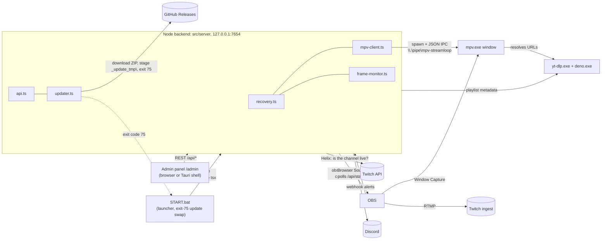
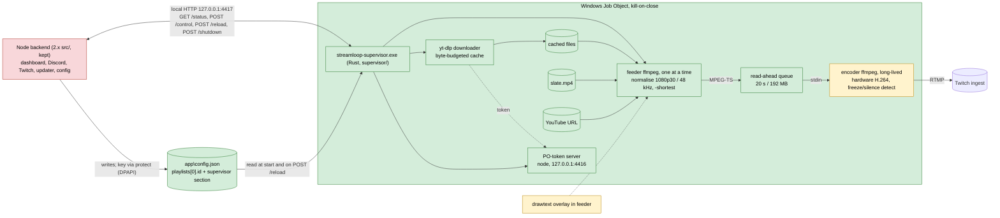

# Architecture

How the parts fit. Direction, decisions and spike results live in the Notion pages named at the end; this file is structure only.

## What it is

Streamloop restreams a YouTube playlist to Twitch around the clock from one Windows box. Two generations sit in this repo. **2.x** (`src/`) is live: a Node/TypeScript backend plays the playlist in mpv and drives OBS, which captures the mpv window and streams. **3.0** is in progress: a headless ffmpeg pipeline under a Rust supervisor, with no mpv, OBS or desktop session. The supervisor is product code in `supervisor/` (hardened from spike 5); `spikes/` keeps the spikes that proved it. The 2.x Node backend is meant to stay and drive the supervisor over local HTTP.

## 2.x today

- `src/server/index.ts`: wires every component by dependency injection, serves `/admin` and `/overlay`, opens the admin page on boot unless `autoOpenAdmin` is off, exits 75 after a staged update.
- `config.ts` / `types.ts`: Zod schema and defaults for `config.json` (gitignored), hot reload via `POST /api/config`.
- `state.ts`: playback position in `state.json`, debounced 2 s writes, suppressed during recovery.
- `mpv-client.ts` / `mpv-args.ts`: spawns mpv, talks JSON over the named pipe, polls properties, receives events.
- `recovery.ts`: 5 s heartbeat, stall / video-freeze / premature-EOF / non-playing detectors, in-place URL retry, then RetryCurrent, RestartMpv, CriticalAlert.
- `frame-monitor.ts`: hashes OBS screenshots to catch a frozen picture mpv reports as healthy.
- `obs-client.ts`: obs-websocket connection, streaming control, screenshots.
- `playlist-metadata.ts`: yt-dlp flat playlist fetch, cached for the dashboard.
- `event-store.ts`: recovery timeline as daily JSONL in `logs/`.
- `discord.ts`: webhook notifications with templates.
- `twitch.ts`: Twitch liveness check (app token + Helix streams) cross-checked with OBS's streaming state.
- `api.ts`: REST surface for the dashboard and overlay; masks secrets in `GET /api/config`.
- `updater.ts` / `ytdlp-updater.ts`: GitHub Releases updater (slim ZIP preferred, SHA-256 verified); yt-dlp self-update.
- `logger.ts` / `file-log-transport.js`: pino to console and file.
- `spawn-cwd.ts`: the temp folder every child process starts in, so nothing holds `app\` during the update swap.
- `src/admin/`: dashboard (status, timeline, transport, config, update button). `src/overlay/`: now-playing page for the OBS Browser Source.
- `scripts/START.bat`: preflight, half-swap self-heal, exit-code branching (75 update, 0 stay down, else restart in 10 s), launcher trampoline via `START.bat.new`.
- `build/prepare-release.js`: full ZIP (`node\`, `mpv\`, `yt-dlp\`, `app\`, `START.bat`) and slim update ZIP, each with `.sha256`.
- `shell/`: Tauri thin shell (stage 1 of the standalone admin UI track) that shows the local `/admin` in WebView2; not part of the release ZIP yet.

## 3.0 target

Green is proven by a spike or by the stage 2 runs against local MediaMTX, amber is proven only in part, red is design.

| Part | Status | Evidence |
|------|--------|----------|
| Feeder → read-ahead → encoder → RTMP, no drop at seams | Proven | Spike 1 (`spikes/continuity/`): 2 h soak, 1,663-seam stress, 1 h Twitch |
| drawtext now-playing overlay in the feeder | Proven; wired into the supervisor's video feeders (`supervisor/src/overlay.rs`, off with `overlay: false`, none on the slate) | Spike 3 (`spikes/overlay/`), render check at `-ss 600`; on in every stage 2 run |
| Byte-budgeted download cache, standby slate | Proven | Spike 4 (`spikes/buffer/`) |
| Supervisor: process model, Job Object, controls, URL cold start, recovery ladder, token server, YouTube breaker | Proven as product code in `supervisor/` | Spike 5 (`spikes/supervisor/`); stage 2 runs A (1 h, 12 controls), B (every fault) and C (crash and resume) against local MediaMTX with `supervisor/scripts/`, tools only from the install layout |
| Freeze and silence watchdog in the encoder (`freezedetect` -50 dB, `silencedetect`) | Proven against injected faults | Stage 2 run B: freeze acted on 25.1 s after the frozen picture went out and healed, silence at 35.2 s and retried once; no verdict on normal content over runs A and B |
| Hardware encoder on the real box | Open, deferred to the product trial | Spike 2 (`spikes/encoder/`): kit built and dry-run on NVENC and AMF; the box run was skipped (the box has an RTX 2070, NVENC). A first-run setup check in the product detects the encoder by test encode. The supervisor still accepts `libx264` |
| Node as HTTP client of the supervisor | Design | Spike 5 and the stage 2 runs drove the API from `drive.mjs`; nothing in `src/` talks to the supervisor yet |
| Supervisor config from `config.json`, `POST /reload` with a live playlist switch, DPAPI key via `protect`, install layout | Proven | Stage 2: run A streamed on a protected key, the key never reached `data\` (grep, runs A to C); a reload switched to another playlist's video 0 and back |
| Launch by Node, own folder next to `node\`, binary updates | Design | Spike 5 spec |

## Supervisor interface (3.0)

- **Install layout** under the root (`--root`, default the parent of the exe's folder; `supervisor/src/paths.rs`): `ffmpeg\ffmpeg.exe`, `yt-dlp\yt-dlp.exe`, `yt-dlp\deno.exe`, `yt-dlp\plugins\`, `pot\build\main.js` (token server), `node\node.exe`, `supervisor\streamloop-supervisor.exe`, `supervisor\slate.mp4`, `app\config.json`, `data\`. Every tool is called by full path, never through PATH; yt-dlp gets `--ffmpeg-location` for its merge.
- **CLI:** `streamloop-supervisor.exe [--root DIR] [--config FILE] [--data DIR]`. Dev only: `--target URL` (replaces ingest and key, for local MediaMTX) and `--debug-faults`, which also unlocks the test knobs (`--url-ttl-s`, `--url-refresh-margin-s`, `--limit-rate`, `--start`, `--max-videos`, `--hours`). `streamloop-supervisor.exe protect` reads a stream key on stdin and prints a DPAPI blob (current user) for `supervisor.streamKeyProtected`.
- **Config** (`app\config.json`, owned by Node): `playlists[0].id` plus a `supervisor` object: `ingestUrl`, `streamKeyProtected`, `encoder`, `cacheBudgetMb`, `readAheadSeconds`, `playerClient`, `overlay`, `freezeSeconds`, `silenceSeconds` (minimums: read-ahead 2 s, freeze and silence 5 s, cache 50 MB). Read at start and on `POST /reload`, which applies what it can live, reports `restartRequired` for ingest, key, encoder and the freeze and silence durations, and switches to a new playlist's video 0 when `playlists[0].id` changes.
- **HTTP** on 127.0.0.1:4417: `GET /status` (`state`: `starting`, `playing`, `recovering`, `needs-stream-key`, `waiting-for-playlist`, `stopping`; `reason`; `streamKeyProblem`; now playing; encoder alive, speed, CPU; watchdog; YouTube breaker; token server), `POST /control` (`{"cmd"}`: `next`, `prev`, `restart`, `jump` with `index`, or `restart-encoder` with an optional `reason` of up to 200 characters), `POST /reload`, `POST /shutdown`, and `POST /debug/fault` only with `--debug-faults`. With no usable key it stays up in `needs-stream-key` and a reload with a working key starts the encoder.
- **Data** (`data\`): `state.json` (resume point), `cache\` (wiped at start, so a resume plays from its URL), `logs\` with daily files (`events-DATE.jsonl`, `seams-`/`controls-`/`encoder-`/`downloads-`/`deletes-`/`buffer-DATE.csv`, `ytdlp-`/`tokenserver-DATE.log`), one log per ffmpeg process, `run.json` and `playlist.json`; a week is kept and the key is redacted from all of it.
- **Measuring harness:** `supervisor/scripts/` (`dev-root.mjs` builds a dev root in this layout, `session.mjs` runs one session against local MediaMTX, `drive.mjs` drives it over HTTP only, `analyze.mjs` computes the verdict).

## Main flows (3.0)

- **Seam.** A new feeder starts when the timeline is less than 20 s ahead of the encoder. It begins at timeline offset = last video PTS written + one frame, so timestamps stay continuous. The encoder never sees a seam as anything but more MPEG-TS.
- **Control (next, prev, restart, jump).** All four are `switch(index, 0)` computed from `P_view` (what the viewer sees, not what the feeder has reached): kill the feeder, flush the queue from the first video PES at least 1 s past the writer, start the target feeder on the continuing offset from the cached file or, if not on disk, its URL (slate covers the resolve). Last command wins. `restart-encoder` (for Node's Twitch checks) takes the encoder-down path of recovery step (3) and logs `encoder-restart-requested` with the caller's reason.
- **Cold start.** Slate on air at once; the first video's URL is resolved (`yt-dlp -j`, waits for `available_at`) and switched in; the downloader fetches that video first; when the file is complete the URL feeder is killed and a file feeder continues at `P_fed` with no flush.
- **Recovery.** (1) Feeder fails, stalls (no video PES for 10 s) or ends early: restart in place at `P_fed`, 2 tries per video. A picture the encoder's `freezedetect` finds frozen for `freezeSeconds`, or audio silent for `silenceSeconds` (counted from 5 s into a seam, never on the slate), gets one restart in place; if the same stretch is still there after it, the stillness is the video's own: the watchdog event's outcome is `content`, play goes on and nothing is skipped. A later, separate stretch gets its own retry. (2) Then skip; 3 skips in a row is critical. A video YouTube will not serve (removed, private, blocked, age-gated) is skipped at once; from the third such video in a row (no successful resolve between them) each one counts toward the breaker. When every video has been skipped, the slate airs for 60 s, doubling to 30 min, before the list is tried again. (3) Encoder exits or its progress stops for 10 s: restart with backoff, probing the ingest port; current video resumes at `P_view`. (4) Supervisor crash: Job Object kills every child, Node relaunches it, it resumes from `state.json`.

## Invariants

- The RTMP connection survives every seam, control and feeder failure; only an encoder restart drops it. (Spike 1, spike 5)
- Nothing in `src/` imports from `spikes/`. Spike code is throwaway; what carries forward is command lines and measurements. (Notion rules; true today)
- Secrets are never committed, printed or logged. 2.x keeps them in gitignored `config.json` and masks them in `GET /api/config`; spike scripts read `TWITCH_STREAM_KEY` from the environment. 3.0 keeps the key DPAPI-protected in `config.json` and redacts it from every log, event and `run.json` it writes.
- Every child dies with its parent: 3.0 children live in the supervisor's kill-on-close Job Object; 2.x spawns every child with `cwd: SPAWN_CWD` so none holds `app\` during an update.
- YouTube traffic from the supervisor goes through one gate: resolves at least 5 s apart, and a circuit breaker that stops all yt-dlp on a bot check or 3 failed resolves (backoff 1, 2, 5, 10, 30 min).
- `START.bat` never overwrites itself in place, and its parenthesised blocks use `rem`, never `::` (`launcher.test.ts`).
- State is not written while a recovery or switch is in progress, so a transient position cannot overwrite the resume point.
- Media bytes never pass through a loop that also does disk writes or control work, and a critical output is never teed synchronously with a non-critical one. (Spike 1 lessons)
- The supervisor is a sibling of Node, not its child: Node restarts and app updates must not drop the stream.
- 2.x (from 2.3.7) will not start its OBS stream while `GET 127.0.0.1:4417/status` reports `encoder.alive: true`, so 3.0 must keep that endpoint and field. The check fails open: anything else lets 2.x stream (`src/server/stream-guard.ts`).
- 2.x (from 2.3.7) only updates to releases with its own major version; 3.x releases are never marked "latest" on GitHub, because older 2.x installs still read it.

## Where things live

- **Notion** for direction, decisions and spike results: the Notion page *Streamloop* (product direction, 2.x roadmap), *Streamloop 3.0: pipeline spikes* (rules, spike verdicts) and *Streamloop 3.0: product build* (build plan). Fragile assumptions are tracked in the **watch list** at the bottom of the 3.0 spikes page.
- **GitHub issues** for bugs: [Sponsorn/streamloop/issues](https://github.com/Sponsorn/streamloop/issues).
- **This file** for structure. Code-level detail stays in `CLAUDE.md` and the code.
