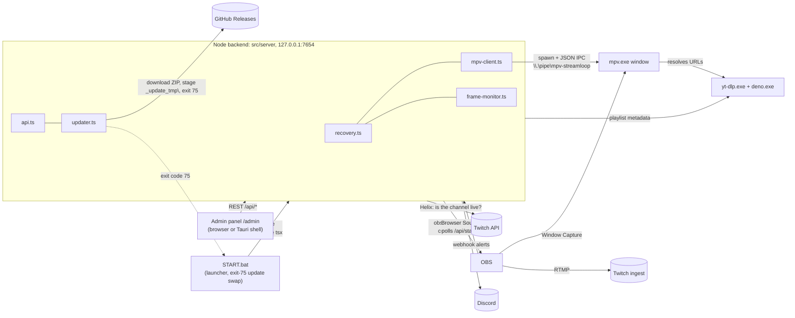
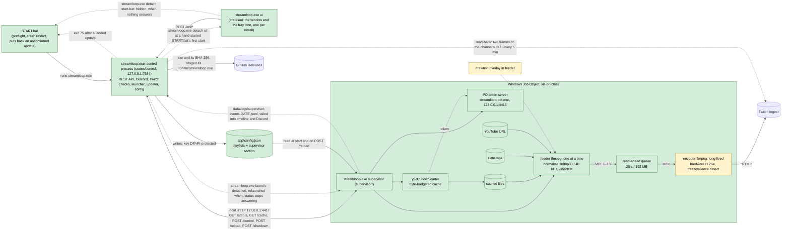

# Architecture

How the parts fit. Direction, decisions and spike results live in the Notion pages named at the end; this file is structure only.

## What it is

Streamloop restreams a YouTube playlist to Twitch around the clock from one Windows box. This branch holds **3.1**: one Rust `streamloop.exe`, built from the Cargo workspace at the repo root, that runs as three processes: the streaming core, the control process and the app. The streaming core (`streamloop.exe supervisor`, the `supervisor/` crate) plays the playlist through a headless ffmpeg pipeline and pushes RTMP itself, with no mpv, OBS or desktop session. The control process (`streamloop.exe control`, or plain `streamloop.exe` under `START.bat`; `crates/control/`) serves the REST API the app uses, sends Discord alerts, runs the Twitch checks, launches the core and updates the exe. `START.bat` starts the control process and restarts it after a crash. Plain `streamloop.exe` anywhere else opens the app (`streamloop.exe ui`, `crates/ui/`): the window and the tray icon, one per install, which starts `START.bat` hidden when nothing answers. The exe is a GUI program that opens no console window, and there is no web dashboard. The supervisor runs the PO-token server `streamloop-pot.exe`, built from `tokenserver/` and shipped in the full ZIP, which holds no Node; an install that took only the exe through the updater keeps bgutil's TypeScript server and its Node as the fallback until it gets the full ZIP. `spikes/` keeps the spikes that proved the pipeline. **3.0**, where a Node backend in `src/server/` did the control process's work, lives on the `3.0` branch; **2.x** (mpv and OBS) on the `2.x` branch.

## 2.x (the `2.x` branch)

This section describes the `2.x` branch. None of these mpv or OBS modules exist on this branch.

- `src/server/index.ts`: wires every component by dependency injection, serves `/admin` and `/overlay`, opens the admin page on boot unless `autoOpenAdmin` is off, exits 75 after a staged update.
- `config.ts` / `types.ts`: Zod schema and defaults for `config.json` (gitignored), hot reload via `POST /api/config`.
- `state.ts`: playback position in `state.json`, debounced 2 s writes, suppressed during recovery.
- `mpv-client.ts` / `mpv-args.ts`: spawns mpv, talks JSON over the named pipe, polls properties, receives events.
- `recovery.ts`: 5 s heartbeat, stall / video-freeze / premature-EOF / non-playing detectors, in-place URL retry, then RetryCurrent, RestartMpv, CriticalAlert.
- `frame-monitor.ts`: hashes OBS screenshots to catch a frozen picture mpv reports as healthy.
- `obs-client.ts`: obs-websocket connection, streaming control, screenshots.
- `playlist-metadata.ts`: yt-dlp flat playlist fetch, cached for the dashboard.
- `event-store.ts`: recovery timeline as daily JSONL in `logs/`.
- `discord.ts`: webhook notifications with templates.
- `twitch.ts`: Twitch liveness check (app token + Helix streams) cross-checked with OBS's streaming state.
- `api.ts`: REST surface for the dashboard and overlay; masks secrets in `GET /api/config`.
- `updater.ts` / `ytdlp-updater.ts`: GitHub Releases updater (slim ZIP preferred, SHA-256 verified); yt-dlp self-update.
- `logger.ts` / `file-log-transport.js`: pino to console and file.
- `spawn-cwd.ts`: the temp folder every child process starts in, so nothing holds `app\` during the update swap.
- `src/admin/`: dashboard (status, timeline, transport, config, update button). `src/overlay/`: now-playing page for the OBS Browser Source.
- `scripts/START.bat`: preflight, half-swap self-heal, exit-code branching (75 update, 0 stay down, else restart in 10 s), launcher trampoline via `START.bat.new`.
- `build/prepare-release.js`: full ZIP (`node\`, `mpv\`, `yt-dlp\`, `app\`, `START.bat`) and slim update ZIP, each with `.sha256`.
- `shell/`: Tauri thin shell (stage 1 of the standalone admin UI track) that shows the local `/admin` in WebView2; not part of the release ZIP yet.

## 3.1

Green is proven by a spike or by runs against local MediaMTX on the dev machine (stage 2 to 4 for 3.0, R1's for `streamloop.exe`, R2's for the token server, R4's for the app), amber is proven only in part, red is design.

| Part | Status | Evidence |
|------|--------|----------|
| Feeder → read-ahead → encoder → RTMP, no drop at seams | Proven | Spike 1 (`spikes/continuity/`): 2 h soak, 1,663-seam stress, 1 h Twitch |
| drawtext now-playing overlay in the feeder | Proven; wired into the supervisor's video feeders (`supervisor/src/overlay.rs`, off with `overlay: false`, none on the slate) | Spike 3 (`spikes/overlay/`), render check at `-ss 600`; on in every stage 2 run |
| Byte-budgeted download cache, standby slate | Proven | Spike 4 (`spikes/buffer/`) |
| Supervisor: process model, Job Object, controls, URL cold start, recovery ladder, YouTube breaker | Proven as product code in `supervisor/` | Spike 5 (`spikes/supervisor/`); stage 2 runs A (1 h, 12 controls), B (every fault) and C (crash and resume) against local MediaMTX with `supervisor/scripts/`, tools only from the install layout |
| PO-token server in Rust (`tokenserver/`, shipped as `supervisor\streamloop-pot.exe`) | Proven on the dev machine; not yet on the box | R2 task 13's live runs: downloads with tokens and no 403 on the mweb client, with and without browser cookies; a killed token server was replaced by the supervisor. The 2 h qualification beside 3.0.5's TypeScript server (`pair-session.mjs`, the same machine, playlist and hour, no cookies): the Rust side finished 52 of 52 tries with no 403 on one minter, and the TypeScript side 59 of 267, whose first three minters were refused and the fourth worked; the Rust side refused no video the TypeScript side finished. A 1 h `session.mjs` run with `/invalidate_it` and `/invalidate_caches` called 4 times, 6 min apart: each call was followed by a new minter in the same process (3 for the 4 calls, as the last two had no request between them) and the next download finished on it; all 13 downloads finished with a token, and after its first minute the server stayed at 26 to 31 MB private bytes. The box's 24 h run is still to come |
| Freeze and silence watchdog in the encoder (`freezedetect` -50 dB, `silencedetect`) | Proven against injected faults | Stage 2 run B: freeze acted on 25.1 s after the frozen picture went out and healed, silence at 35.2 s and retried once; no verdict on normal content over runs A and B |
| Hardware encoder on the real box | Open, deferred to the product trial | Spike 2 (`spikes/encoder/`): kit built and dry-run on NVENC and AMF; the box run was skipped (the box has an RTX 2070, NVENC). The product's first-run setup check detects the encoder by test encode and picked NVENC on the dev machine (stage 4 install run); the box itself is still to run. The supervisor still accepts `libx264` |
| The control process as HTTP client of the supervisor (`crates/control`: client, launcher, event bridge, API) | Proven against local MediaMTX; not yet on the box | `node-session.mjs` run A against `streamloop.exe` (30 min, NVENC): the first-run wizard's calls took it live in 16.1 s, 5 dashboard controls each showed in 1.3 to 1.6 s, Discord alerts for a freeze (1), a killed feeder (1) and a killed encoder (drop and restart in one batched post), no duplicates, and the dummy key in no config, log or data file. Stage 3 proved 3.0's Node backend the same way |
| Supervisor config from `config.json`, `POST /reload` with a live playlist switch, DPAPI-protected key, install layout | Proven | Stage 2: run A streamed on a protected key, the key never reached `data\` (grep, runs A to C); a reload switched to another playlist's video 0 and back |
| Launch by the control process, as a sibling that outlives it | Proven against local MediaMTX (`crates/control/src/launcher.rs` through `streamloop.exe launch`, relaunch with backoff) | `node-session.mjs` run B: the control process killed, tree-killed, exiting 75 and sent a console control event each left the same supervisor process streaming with no reader reconnect (largest packet gap 64 to 80 ms), and the restarted control process attached in 506 to 520 ms; a killed supervisor was seen relaunched 8.0 s after the kill and resumed at its saved position (85.3 s); after Stop nothing relaunched for 58 s, and Start launched one supervisor in 2.2 s, live 6.0 s later. Run `treekill`: the supervisor's parent was the exited `launch` intermediate (its `launched` event reported `breakaway: true`), `taskkill /T /F` on the control process left the same supervisor PID streaming (largest packet gap 77 ms, no reader reconnect), and a new control process attached on its first poll. Stage 3 proved the same for 3.0's Node backend |
| Twitch read-back (`crates/control/src/readback.rs`) | Proven against local HLS | `node-session.mjs` run C, with the read-back pointed at MediaMTX's HLS through a test-only override and Twitch never asked: a stale picture (clock included) gave two bad reads, one `restart-encoder`, then the encoder restarted and the stream read as moving again (the script's own grab, diff 6.29); a second stale picture 15.4 min after the restart gave two bad reads, one critical alert and no restart. A `freeze-video` fault is not its case: the overlay clock keeps moving over a frozen picture (clock-region differences 7.2 and 5.9 against a threshold of 1.0), so the encoder's own watchdog handles it |
| Release ZIP and install (`build/prepare-release.js`, `scripts/START.bat`, `streamloop.exe`) | Proven on the dev machine, with the R1 ZIP, and again with R2's, which ships `supervisor\streamloop-pot.exe` and no `pot\` or `node\` | R2's ZIP (`install-session.mjs install`, 2026-11-11): `START.bat`'s preflight passed on the token server exe, the setup check's one "Token server" row found `supervisor\streamloop-pot.exe`, the installed supervisor ran `streamloop-pot 3.1.0-dev`, which minted from the homepage challenge, and the wizard's calls took it live in 22.1 s, 30.7 s after `START.bat` started; the install run's other checks below passed again, and the `faults` run was not repeated. `supervisor/scripts/install-session.mjs install` (the v3.1.0-dev ZIP, NVENC, local MediaMTX; the R1 figures in these rows all come from one `install-session.mjs all` run): the ZIP extracted into a temp folder with a space and an `Ö` in its path and started from its own `START.bat`, hidden; the control process answered in 0.5 s and wrote `config.json` from the example (the ZIP ships none); the wizard's API calls took it live in 28.1 s, 36.3 s after `START.bat` started; one supervisor, launched with breakaway; the root came from the exe's folder, so not dev mode; the dummy key in none of the 8,169 install files. A second `START.bat` window of the same install logged "Port 7654 is in use. Is another StreamLoop running? Close it and start this one again.", exited 2 and left the stream alone (same supervisor, `streamloop.exe`, `config.json` and `_update\` unchanged, largest packet gap 109 ms). The stage 5 gate's fault checks pass unchanged against this install (`faults`): a killed feeder was retried in 71 ms with no reader reconnect, a frozen picture was acted on 20.2 s after it went out, silence was judged content, a killed encoder was back on air in 7.7 s with one drop and one restart alert, and a killed supervisor was relaunched in 6.6 s and resumed the same video. Stage 4 proved the 3.0.0 Node install the same way |
| First-run setup check (`crates/control/src/setup_check.rs`) | Proven on the dev machine | Same run: `POST /api/setup-check/run` tried `h264_nvenc` first and kept it, recommended a 4,096 MB cache, found every dependency, and the wizard saved only the changed cache size |
| Exe updates (`crates/control/src/updater.rs`, `landing.rs`) | Proven on the dev machine; not yet on the box | `install-session.mjs update`, with test builds 3.1.1 to 3.1.4 in a local release list and the planned break moved to 300 s of encoder uptime: the first check staged 3.1.1, fetching only the exe, its checksum and `node-version.txt` (never the ZIP; that was R1's run, and R2 has since removed the `node-version.txt` fetch); the status read `idle` and the notice "It installs by itself in about 1 hour, just before Twitch's 48-hour cut. …". It landed at 301 s: the supervisor stopped 1.0 s in, the new one was live at 3.6 s, and the control process restarted from the new exe and confirmed it at 14.4 s. Off air 8.9 s at the RTMP reader, its own reconnects included. `.old`, `landed` and `_update\` were gone at the confirmation, config and key unchanged, one supervisor and one control process; the timeline and Discord had "Installing StreamLoop 3.1.1. The stream restarts." and "Updated to StreamLoop 3.1.1.", and no critical. With `autoStartStream` off, Update Now to 3.1.2 began landing 0.32 s after the click, relaunched the supervisor anyway and was off air 8.2 s, with the same checks passing. Stopped from the dashboard, 3.1.3 began landing 2.1 s after the check that found it; waiting for Start (`autoStartStream` off, a fresh start with no supervisor), 3.1.4 landed by Update Now. Neither started a supervisor, `streamloop.exe check` confirmed each 16.7 s and 16.8 s after its landing began, the stream stayed stopped or waiting, and Start took each live in 9.0 s. Two changing routes, `POST /player/jump` and `POST /config` with bodies they refuse, were probed every 250 ms from before each landing to after its confirmation: every probe made while `update-state.json` read `running` answered 409 (16 and 13 from the landing control process in the two on-air landings, whose confirmation took milliseconds and so got no probe; 14 and 13 from 3.1.3 and 3.1.4 while their `check` ran), and every other answered 400. R4's run (2026-11-28, R4's branch build, still numbered 3.1.2 before its version bump, with test builds 3.1.3 to 3.1.6, in an `all` run) also started the app before each landing: after each one, an app of the new exe's version (its exe's `--version` against `/api/update/status`) was the only app 0.07 s (planned break, with its window, started with `--follow 3.1.3`), 1.3 s (Update Now, in the tray), 5.6 s (stopped) and 1.3 s (waiting for Start) after the new control process answered, and `streamloop.exe.old` was gone 4.9 s after each confirmation (in the waiting landing it was already gone at the confirmation) |
| Rollback: by the new control process, and by `START.bat` | Proven on the dev machine; not yet on the box | `install-session.mjs rollback`: a 3.1.1 built with the `test-supervisor-fails` feature (its supervisor mode exits at start) landed at the break; its control process answered the two probed routes with 409 throughout its confirmation (706 probes), gave up 181.0 s after it started, put 3.1.0-dev back (`streamloop.exe.bad` holding the failing build, and `data\update-rolled-back` naming 3.1.1), relaunched the old supervisor and sent one critical, "The update to 3.1.1 did not come up, so StreamLoop went back to 3.1.0-dev."; back on air 199.9 s after the landing. `rollback-bat`: a 3.1.1 built with `test-control-fails` landed and its supervisor was live at 3.5 s; `START.bat` printed its `[RECOVER]` line at 14.2 s, 3.1.0-dev's control process came up at 24.4 s and replaced 3.1.1's supervisor by the version rule, live again at 28.1 s (off air 8.9 s at the landing and 8.9 s at the replacement). After either, 3.1.0-dev staged 3.1.1 again with the notice "Update Now installs it and restarts the stream.", and the next planned break left it alone. In R4's run (2026-11-28, the branch build numbered 3.1.2) the app followed the exe both ways in `rollback`: onto 3.1.3 with its window 1.3 s after 3.1.3's control process answered, and back onto 3.1.2 by the time the rollback's control process answered (rollback 199.2 s after the landing); `streamloop.exe.bad` could then be renamed and opened for writing, so no process held it. In `rollback-bat` (rollback 28.8 s, `[RECOVER]` at 14.9 s, and 28.8 s and 14.6 s in a second run the same day) 3.1.3's control process never answered, so the 3.1.2 app stayed, with its window, and `.bad` was free there too |
| Exe updates from a released 3.1.x control process | Proven on the dev machine from v3.1.2; not yet on the box | `install-session.mjs from312` (2026-11-28, in an `all` run): v3.1.2's full ZIP from its GitHub release (checksum checked), each time a fresh install live on the dummy key, and R4's branch build listed as 3.2.0 and 3.2.1. v3.1.2's own updater staged 3.2.0, fetching only the exe and its checksum, and landed it at 301 s of encoder uptime: the supervisor stopped 0.8 s in, the new one was live at 3.8 s, and 3.2.0's control process, started by v3.1.2's `START.bat` with the word `restart`, confirmed it at 14.4 s, off air 9.0 s at the reader; Update Now to 3.2.1 began landing 0.16 s after the click and was confirmed at 13.9 s, off air 8.2 s; stopped from the dashboard, Update Now landed 3.2.1 with no supervisor running, `streamloop.exe check` confirmed it 15.9 s after the landing began, and Start took it live in 31.2 s. Each time the timeline and Discord had the Installing line and the timeline "Updated to StreamLoop 3.2.x.", no critical, `.old`, `landed` and `_update\` were gone, the probed routes answered 409 throughout (from v3.1.2 and, while it confirmed the held landing, from 3.2.1), the new control process's "The update came up" line reached `START.bat`'s output, it kept the one supervisor the landing launched (or Start's) with no version-rule restart, and no window and no app of the install appeared. A `StreamLoop.vbs` planted in v3.1.2's format became the Run value under the test key; one disabled under the test key's `StartupApproved\StartupFolder` became a Run value with the same 12 disable bytes, and 3.2.1's `GET /api/autostart` read `enabled: false`; v3.1.2's autostart route was never called. v2.3.8's own stream guard, run under the Node of its full ZIP (checksum checked) and no 2.x install or OBS, read 3.2.0's refusing 4417 as streaming, and as not streaming once Stop had ended the supervisor, 1.2 s after the Stop |
| The app as one Windows program (`crates/ui` as `streamloop.exe ui`, `detach`, the tray, Quit, autostart) | Proven on the dev machine; not yet on the box | `install-session.mjs app` (2026-11-28, R4's branch build, still numbered 3.1.2 before its version bump; no step that opens a window had to wait behind a full-screen app): `streamloop.exe` started as Explorer starts it (`Start-Process`, no `STREAMLOOP_START`) started `START.bat` hidden; the API answered 2.6 s later and the wizard's calls took it live in 22.1 s (32.9 s after the start), with one app, one `START.bat`, one control process and one supervisor, and the app's window the only visible one of the install's processes. With that window closed to the tray and another program's window in front, a second start exited in 0.56 s, and the app's window was open and in front at the next look, 0.44 s later, with one app process still running (a window that is open but behind is left to the on-screen checks). `ui --root` opened one window, and closing it left the app in the tray; a killed control process answered again 10.3 s later, with the same app and no window; an app started 0.08 s after a second kill, while `START.bat` waited out its 10 s, started no second `START.bat`. Autostart on wrote the Run value `"ROOT\streamloop.exe" ui --tray` (a test key, not the real Run key), and that command, run as logon runs it, took the stream live in 16.9 s with no window; off removed the value; this install's `StreamLoop.vbs` became the Run value, and another install's stayed byte for byte. Nine requests sent through `node:http` (fetch replaces Host) to 7654 and 4417 with a foreign Host, no Host or an `Origin` (one of them Stop with the app's token, two the supervisor's `/shutdown`) got 403 with the refusal text; loopback requests got 200, the supervisor streamed on (largest packet gap 79 ms, no reader reconnect) and `/admin` got 404. `POST /api/quit` with the app's token closed the port in 3.0 s, with the app still running, and 3.7 s after the quit nothing of the install but the app was left. The app exits after its own Quit, which the harness cannot press (`quit.rs`'s tests cover that), so the harness then ended the app, and nothing was left 0.4 s later. The timeline ended on "Quitting StreamLoop. The stream goes off air.", followed only by the supervisor's own "Supervisor shut down"; Discord got the quit line, and no stopped marker was written. With `autoStartStream` on, a plain start was live in 14.8 s |
| Moving from 3.0.5 | Proven on the dev machine, with the R1 ZIP and with R2's; not yet on the box | R2's ZIP (`install-session.mjs move`, 2026-11-11): every check below passed again, and 3.0.5's `pot\` and `node\` were gone at the first start after Stop; with the 3.0.5 supervisor still streaming, its token server still held them at the first start (the new control process replaced that supervisor by the version rule, off air 9.0 s), and the next start removed them. The R1 ZIP's run of `install-session.mjs move`: v3.0.5's full ZIP from its GitHub release (checksum checked) live with a dummy key, then Stop, the window closed, the R1 ZIP extracted over it and `START.bat` started: the stream stayed stopped until Start, which took it live in 9.1 s on the key 3.0.5 had stored, without setting it again; `config.json` kept its key blob, playlist, ingest, encoder and port (its bytes changed once at the first start: a 3.0.5 config gains `autoStartStream`, which its schema lacks); all 6 timeline entries from 3.0.5 still listed; `app\src`, `app\node_modules`, the other 3.0 app files and `supervisor\streamloop-supervisor.exe` gone. Again without Stop: tar left the 47 files the running 3.0.5 supervisor's tools held (`node.exe`, `ffmpeg.exe`, the token server's native modules), each the same as the ZIP's; the new control process replaced the running 3.0.5 supervisor by the version rule ("it runs an unknown version"), off air 9.1 s; the old supervisor exe, still running at that first start, was gone after the next |
| Switching between 3.0 and 2.x | Proven with 3.0.0 | Stage 4 install run 3 (`install-session.mjs` before R1, the v3.0.0 ZIPs): Stop from 3.0's dashboard ended the supervisor in 1.3 s, then 3.0's Node tree was killed; v2.3.8's full ZIP (checksum verified) started beside it, its dashboard answered on 7654 and its own stream guard, run as a module under 2.x's Node (its call site is OBS's stream start, and no OBS ran), read `127.0.0.1:4417/status` as not streaming; 2.x shut down cleanly; 3.0 started again and stayed stopped for 30 s with no supervisor, Start took it live in 18.1 s, and 2.x's guard then read it as streaming |
| Several playlists in one ring, moving on at a list's end | Proven against local MediaMTX; not yet on the box | `session.mjs --drive advance` (two real playlists, NVENC, starting 90 s before the first list's end): the next list's first video finished downloading 45 s before its feeder started and aired from the file; first list to second with no reader reconnect and the same encoder generation (largest packet gap 86 ms, largest timestamp step 22 ms, none backwards); a settings save moved nothing; a restart resumed in the second list at its saved position, with the first list joining behind it; the second list's end went round to the first with no reconnect; a reload naming a list was on air in 2 s; `config.json` unchanged. Dashboard checked in a browser against the same setup: ▶ on the other list, the dropdown and highlight following, Next crossing back, ▶ while stopped refused |
| The REST API of 3.0's Node backend, kept | Proven by replay | `api-parity.mjs` replays the dashboard's 86 requests against `target\release\streamloop.exe` with a fake supervisor, and `compare` finds them equal to Node's recording apart from two named differences (see Control process); unit tests per module, and `tests/app.rs` drives the wired process on a real socket |
| Binary updates of `ffmpeg\` and `supervisor\streamloop-pot.exe` | The full ZIP by hand; the updater delivers only `streamloop.exe` | Extracting the full ZIP over an install keeps config, key, `data\` and the timeline (see Moving from 3.0.5). yt-dlp keeps itself current with `yt-dlp -U` when the control process starts, and at most once an hour while YouTube lookups are paused |

## Workspace and modes

- **Crates.** The Cargo workspace at the repo root (`workspace.package.version` is the version; `package.json` carries the same number, from which the release build names the ZIP and the exe, and a test fails when they differ): `crates/streamloop` is the exe and only dispatches on its first argument; `supervisor/` is the streaming core as a library, whose HTTP server on 4417 is tiny_http 0.12.0 vendored in `vendor/tiny_http` with one patch (its additions are marked `streamloop:`): a request dropped with more than 64 KiB of its body unread closes its connection instead of reading the rest into a buffer that size, and a smaller remainder is drained through a fixed 8 KiB buffer. The root `Cargo.toml` puts it in place of the crates.io release through `[patch.crates-io]` and excludes it from the members, so its own tests and dev-dependencies stay out of the workspace. The token server on 4416 serves through the same copy: the root's patch does not reach `tokenserver/`, so `tokenserver/Cargo.toml` names `../vendor/tiny_http` in its own `[patch.crates-io]`; `crates/control` is the control process (tokio, axum, reqwest with rustls); `crates/common` holds what the processes share (the config loader, the `/status`, `/control`, `/reload` and `/cache` types, the install layout, DPAPI, `procs::command`, the time helpers) and has no async runtime; `crates/ui` is the app, the window and the tray icon, as a library (gpui-kit `=0.9.0`, its own API types), run by the exe's `ui` mode. Build output goes to `target\` at the root. `tokenserver/` (`streamloop-pot.exe`: it links V8 and needs the static CRT its own `.cargo/config.toml` sets), `spikes/gpui-ui`, `spikes/supervisor` and `shell/src-tauri` build on their own, outside the workspace.
- **Modes.** The first argument names the mode (`crates/streamloop/src/dispatch.rs`). With no mode word, the exe is the control process when `STREAMLOOP_START` is set, which every `START.bat` since 3.1.0 does, and the app otherwise; every argument then goes to that mode, so `streamloop.exe --root DIR` under `START.bat` is the control process, as in 3.1. An argument the mode does not take prints its usage line and exits 64.
- **No console.** `streamloop.exe` is a Windows GUI program, so a double-click opens no console window. Whether it attaches to a console depends on the mode, not on the handles it was given. `control`, `check`, `protect` and `--version` attach to the console of the process that started them (`streamloop_common::console::attach_parent`) unless their standard output is a pipe or a disk file, which then stays their output; NUL and no handle at all both attach. cmd passes a GUI child its NUL but none of its console handles, so the control process ends up on `START.bat`'s console whether that window shows or is hidden, and Ctrl+C or closing the window reaches it; a NUL output stays NUL after the attach, so under a hidden `START.bat` its lines go only to its log in `app\logs\`. Output redirected to a file keeps it off that console. `ui`, `detach`, `launch` and `supervisor` never attach; `detach` starts `START.bat` with a hidden console of its own for cmd and its children to share. A cmd or PowerShell prompt does not wait for a GUI program (a batch file, a pipe, `start /wait` and a process that spawns it do), so by hand: `streamloop.exe --version | more`, and `start /wait "" streamloop.exe control --root DIR` for the control process in that console.

| Command | Runs | Started by |
|---------|------|------------|
| `streamloop.exe [--root DIR]` with `STREAMLOOP_START` set, or `streamloop.exe control [--root DIR]` | the control process, on the console it was started from | `START.bat`; `control` for the harness and dev |
| `streamloop.exe [--root DIR] [--port N] [--tray] [--follow V]` with `STREAMLOOP_START` not set, or `streamloop.exe ui [...]` | the app: the window and the tray icon (`crates/ui`); 64 for bad arguments | a double-click, the autostart entry (`ui --tray`), `detach ui`, `ui-session.mjs` |
| `streamloop.exe detach ui [ARGS]` or `streamloop.exe detach start-bat [--root DIR]` | the intermediate that starts `streamloop.exe ui ARGS` (detached, no console) or `START.bat` (through `cmd.exe /d /s /c ""ROOT\START.bat""` with a hidden console, `STREAMLOOP_FROM_APP=1` set and `STREAMLOOP_START` removed), then exits: 0 once started, 1 when the start failed, there is no root or `ROOT\START.bat` is missing, 64 for bad arguments | the app, to start `START.bat` when nothing answers and to open or restart its window; the control process, to open the window at a hand-started `START.bat`'s first start |
| `streamloop.exe supervisor [--root DIR] [--config FILE] [--data DIR] [dev flags]` | the streaming core | the `launch` intermediate; `session.mjs` directly |
| `streamloop.exe launch --root DIR [--debug-faults]` | the intermediate that starts the core detached and exits | the control process's launcher |
| `streamloop.exe check [--root DIR]` | proves the core runs, without streaming | the control process, to confirm an update while the stream is held |
| `streamloop.exe protect` | DPAPI helper on stdin | the harness only; the control process protects in-process |
| `streamloop.exe --version` | prints the version and exits 0 | the updater's check of a staged exe, `verify-release.mjs`, the harness |

- **Process tree.** `START.bat`, then the control process, which runs `launch`, which exits and leaves the supervisor with a dead parent in its own kill-on-close job. The control process never enters that job. When the app starts the stream it runs `detach start-bat`, which starts cmd on `START.bat` and exits, so the tree is the app, `detach` (gone), cmd, the control process, `launch` (gone), the supervisor; to open or restart the window the app or the control process runs `detach ui`, which starts the app with no living parent. Both starts leave the caller's job when its job allows breakaway (`CREATE_BREAKAWAY_FROM_JOB`, dropped when the job refuses it, as `launch` does). `START.bat` gets a hidden console (`CREATE_NO_WINDOW`), never `DETACHED_PROCESS`, since a console child of a detached cmd opens a window of its own; the control process then attaches to that console. Proven on the dev machine with Windows Terminal as the default terminal: `detach start-bat` brought the stream up with no window and no `WindowsTerminal` process, and `POST /api/shutdown` left no cmd behind.

## Supervisor interface

- **Install layout** under the root (`crates/common/src/paths.rs`): `streamloop.exe`, `ffmpeg\ffmpeg.exe`, `yt-dlp\yt-dlp.exe`, `yt-dlp\deno.exe`, `yt-dlp\plugins\`, `supervisor\streamloop-pot.exe` (token server), `supervisor\slate.mp4`, `app\config.json`, `app\config.example.json`, `app\logs\` (the control process's log and timeline, and the app's `ui.log`), `app\window.json` (where the app's window was), `data\`. While an update is on its way: `_update\streamloop.exe` (staged), `_update\landed` (written by a landing), `streamloop.exe.old` (the previous exe until the update is confirmed and the app that ran from it has quit) and, after a rollback, `streamloop.exe.bad`. Every tool is called by full path, never through PATH; yt-dlp gets `--ffmpeg-location` for its merge. yt-dlp reads its own modules from its exe while it runs, so its self-update (the control process's `ytdlp_update.rs`) never replaces an exe in use: it runs `-U` on a copy, `yt-dlp\yt-dlp-update.exe`, keeps the result as `yt-dlp\yt-dlp-<version>.exe` and removes all but the two newest such copies (Windows refuses to delete one that still runs, so it goes at a later update). Every yt-dlp run, the supervisor's and the control process's, takes the newest copy, else `yt-dlp\yt-dlp.exe` (`paths::ytdlp_to_run`). yt-dlp.exe unpacks about 30 MB into `TMP` at every start and removes it only when it exits on its own, so every run gets its own `TMP` and `TEMP`, `yt-dlp\temp\OWNER-PID-N\` (`streamloop_common::ytdlp_temp`, OWNER `supervisor` or `control`), removed when the run ends, killed or not. Each new run first removes the folders its owner's earlier runs left (a supervisor killed mid-download leaves one), except one Windows will not rename because a running yt-dlp still holds it. The supervisor runs `streamloop-pot.exe server` for the PO-token server, or adopts one already answering on 4416, and records which one answered in `/status.tokenServer.server` and the `token-server-adopt` event. When that exe is missing but `node\node.exe` and `pot\build\main.js` are still there, it runs bgutil's TypeScript server instead, so an install updated through the updater, which delivers only `streamloop.exe`, keeps its tokens until the full ZIP is installed. `node\node.exe` and `pot\build\main.js` are that fallback's, outside the layout the release guard checks: the full ZIP ships neither. `Layout::token_server_choice` (`streamloop_common::paths`) is the one rule for which server runs, and both the supervisor's spawn and the control process's setup check ask it. yt-dlp loads only the install's plugin (`--no-plugin-dirs` before `--plugin-dirs`), pointed at the token server the supervisor watches.
- **Packaging** (`build/prepare-release.js`): `cargo build --release -p streamloop` at the repo root, then the install layout in `build/release-layout.js`: `streamloop.exe`, `START.bat`, `app\config.example.json`, `supervisor\slate.mp4`, `supervisor\streamloop-pot.exe`, `ffmpeg\`, `yt-dlp\` (with deno and the plugin zip) and `data\`, plus `README.txt` (`scripts/README.txt`). `streamloop-pot.exe` is built by `cargo build --release` inside `tokenserver/`, which is no workspace member (it links V8 and needs the static CRT its own `.cargo/config.toml` sets), and the ZIP holds no Node. The build writes `dist/streamloop-vX.Y.Z.zip`, `dist/streamloop-vX.Y.Z.exe` (the updater's download) and a `.sha256` for each; there is no update ZIP and no `components.json`. No ZIP ships `app\config.json`; the control process creates it from `config.example.json` on first start, so a reinstall keeps the user's. `crates/streamloop/tests/release_layout.rs` checks the layout against `Layout` in `crates/common/src/paths.rs`, and `build/verify-release.mjs` checks the ZIP, that its exe prints the ZIP's version, and that its token server, started on a free local port, answers `/ping` with `streamloop-pot` and that version.
- **CLI.** `streamloop.exe supervisor [--root DIR] [--config FILE] [--data DIR]`; the default root is the exe's own folder. Dev only: `--target URL` (replaces ingest and key, for local MediaMTX) and `--debug-faults`, which also unlocks the test knobs (`--url-ttl-s`, `--url-refresh-margin-s`, `--limit-rate`, `--start`, `--max-videos`, `--hours`, and `--api-port` and `--token-port`, which move the supervisor off 4417 and 4416 so a second one can run beside it; `launch` always waits on 4417). `streamloop.exe launch ARGS` starts `streamloop.exe supervisor ARGS` through a short-lived intermediate: it re-execs the same exe detached, in a new process group and outside the caller's job (`CREATE_BREAKAWAY_FROM_JOB`; when the job refuses breakaway it starts inside the job instead), logs a `launched` event with `breakaway: true|false`, waits up to 3 s for the port to answer or the child to exit, and exits 2 when the child found the port taken, 3 when it refused `config.json`, else 0. The supervisor binds its port before it reads `config.json`, so 2 only ever means the port is taken; a refused config logs a critical `config-refused` event with the reason and exits 3. Any other exit during the wait is 1. `streamloop.exe check` (the same flags as `supervisor`) proves the binary runs without streaming: it reads `config.json` as startup does, requires the tools in the install layout and a token server it can run (`streamloop-pot.exe`, else the TypeScript fallback), runs `ffmpeg -version` and starts that token server on port 4418, pinging `/ping` once a second until it answers, for up to 15 s from its start (the grace the supervisor's own token watchdog gives a new server), then stops it; it binds neither 4417 nor 4416, enters no job and touches neither cache nor state. It prints `ok` and exits 0, else prints `streamloop-supervisor check: <reason>` on stderr and exits 1; the control process strips that prefix when it confirms an update. `streamloop.exe protect` reads a stream key on stdin and prints a DPAPI blob (current user) for `supervisor.streamKeyProtected`.
- **Config** (`app\config.json`, owned by the control process): `playlists` (each `id`, in play order) plus a `supervisor` object: `ingestUrl`, `streamKeyProtected`, `encoder`, `cacheBudgetMb`, `readAheadSeconds`, `playerClient`, `overlay`, `freezeSeconds`, `silenceSeconds` (minimums: read-ahead 2 s, freeze and silence 5 s, cache 50 MB), and the top-level `ytdlCookiesFromBrowser` it shares with the control process (empty for none; passed to every yt-dlp call as `--cookies-from-browser`, applied live). The supervisor reads it read-only through `streamloop_common::config`, the loader the control process uses: a blank `ingestUrl` or `playerClient` and a missing `supervisor` object mean the defaults, and an empty `streamKeyProtected` means no key. Read at start and on `POST /reload`, which applies what it can live, reports `restartRequired` for ingest, key, encoder and the freeze and silence durations, and brings the ring in line with `playlists` (see Playlists under Main flows). Nothing writes the order back: it stays as the user set it.
- **HTTP** on 127.0.0.1:4417 (the request and reply shapes live in `streamloop_common::api`): `GET /status` (`state`: `starting`, `playing`, `recovering`, `needs-stream-key`, `waiting-for-playlist`, `stopping`; `reason`; `streamKeyProblem`; now playing, with `playing.playlistId` naming the list on air, and `playing.index` and `playlistCount` counting within it; `version` (the exe's build version); encoder alive, speed, CPU and `uptimeS` (whole seconds since the encoder started, `null` with none); watchdog; YouTube breaker, with `bot` saying whether its last failure was a bot check rather than failed lookups; token server, with `server` naming which one answers, `null` until it has), `POST /control` (`{"cmd"}`: `next` and `prev`, which cross into the neighbouring list at a list's end, `restart`, `jump` with an `index` in the list on air and an optional video `id` that wins when the ring has it, or `restart-encoder` with an optional `reason` of up to 200 characters), `POST /reload` (optional `{"playlist", "index", "id"}`: `playlist` goes to that configured list and refuses any other, `index` and `id` say where in it to start, by id when the list has it, else the index clamped to the list; a supervisor before `playlist` existed plays only `playlists[0]` and names no list in `/status`, and the control process then answers that the full ZIP is needed), `GET /cache` (what the cache view shows, refreshed about once a second: `cacheBytes` against `budgetBytes`; `next`, what the downloader does next and when, as `when` (`downloading`, `now`, `size-lookup`, `after-failure`, `cookies`, `youtube-paused`, `retry`, `room` or `nothing`) with `at` and the video it names; `videos`, every video from the one on air through the look-ahead, each with its `state` (`on-air`, `cached`, `downloading`, `queued`, `size-unknown`, `failed`, `skipped`, `waiting-for-room`), its size, its download progress, `retryAt` or `roomAt`, and for a file on disk its resolution, frame rate, codecs, bitrate, format ids, player client and finish time from `cache.json`; `deletions`, the last 20 files the cache removed and why), `POST /shutdown`, and `POST /debug/fault` only with `--debug-faults`. Before routing, every request is checked (`streamloop_common::local_only`): a Host other than `127.0.0.1:PORT` or `localhost:PORT` (the port `serve` bound, so `--api-port` moves it), a missing Host, or any `Origin` header is refused with 403 and `{"error":"Forbidden: requests from a browser are refused"}`, `/status` and `/shutdown` included. With no usable key it stays up in `needs-stream-key` and a reload with a working key starts the encoder.
- **Data** (`data\`): `state.json` (resume point: the list on air, the video's id and number in that list, its position), `cache\` (finished `<id>.mp4` downloads survive a restart and count toward the budget once a list names them; partial files are removed at start, and files no video claims once every configured list has answered), `cache.json` (what each cached file is: its resolution, frame rate and codecs as ffmpeg reads them after the download, and the format ids, player client and finish time of that download; a file kept from before the record existed is read with ffmpeg at start, and records of files that are gone are dropped at the next write), `logs\` with daily files (`supervisor-events-DATE.jsonl`; up to 3.0.4 it was `events-DATE.jsonl`, which the control process still reads; `seams-`/`controls-`/`encoder-`/`downloads-`/`deletes-`/`buffer-DATE.csv`, where each `deletes-` row ends with why the file went: `played`, `outside-look-ahead` (playout removed it before it aired: a jump, a smaller budget), `not-in-playlist` (a switch or reload dropped its list, or no list claims a kept file) or `unreadable` (it failed before its first frame); `ytdlp-`/`tokenserver-DATE.log`), `pot\` (`streamloop-pot.exe`'s data folder), one log per ffmpeg process, `run.json` and `playlist.json` (the list on air with its playlist id, played when the fetch at start fails); a week is kept and the key is redacted from all of it. Video numbers in events and CSVs count within their list, so `id` is what tells two lists' videos apart. The control process keeps its own files here too: `stopped-by-user` (written on the dashboard's Stop, removed on Start and read at every start, so a stopped stream stays stopped across restarts), `waiting-for-start` (a start held until Start, so a crash restart keeps holding), `setup-check.json` (the last setup check), `update-state.json` (a landing and its confirmation: from and to version, step, result, reason, in the shape the dashboard's update banner reads) and `update-rolled-back` (the record of an update that was rolled back; that version then waits for Update Now).
- **Twitch read-back** (the control process, `readback.rs`): every 5 min while live, two frames of the channel's own HLS 5 s apart through `ffmpeg\ffmpeg.exe`; if the overlay clock stands still twice in a row while Helix says live, the control process asks for `restart-encoder`, at most once per 30 min (a clock it shares with the Helix check), then only alerts.
- **Launch** (the control process, `launcher.rs`): it polls `GET /status` every 2 s and, after 3 misses, runs `ROOT\streamloop.exe launch --root ROOT` hidden and with no stdio (backoff 10 s, 30 s, 60 s, 5 min, reset after 60 s running). An exit code 2 from the intermediate within 5 s of the spawn means another supervisor holds the port, and the control process attaches to it. Exit 3 counts as down, and `/api/status` shows "The supervisor refused config.json: <reason>" (from the last `config-refused` event) until a supervisor answers. `POST /api/config` refuses a `ytdlCookiesFromBrowser` over 200 characters or with a control character, so a save cannot write a config the supervisor refuses. `START.bat` sets `STREAMLOOP_START` (`first` after the window opens, `restart` after any other exit, `rollback` for the first start after its rollback); with `autoStartStream` off, a `first` start holds the launch (`data\waiting-for-start`, launcher state `ready`) until Start, and a `restart` keeps holding only while that marker exists. Recovery ignores that hold: a supervisor that answers is attached and ends it, and one that dies is relaunched. An update never changes whether the stream is held: a start that finds `_update\landed`, and a `rollback` start, hold only when the record (`_update\landed`, or `data\update-rolled-back` for a rollback) says the stream was held before the landing; any other launches as usual, so a launch the guard held during the landing is tried again within the confirmation. A `rollback` start whose record cannot be read follows `autoStartStream`. A supervisor that reports another version than the control process, or none (a 3.0 one), is shut down (its `version` and `encoder.alive` are read even when the rest of its status does not parse) and launched again from this exe, at most once in 5 min, unless the stream was stopped from the dashboard. It never stops the supervisor otherwise, except for the dashboard's Stop stream, after which it relaunches nothing until Start. `STREAMLOOP_DEBUG_FAULTS=1` adds `--debug-faults`, for test runs only.
- **Measuring harness:** `supervisor/scripts/` (`dev-root.mjs` builds a dev root in this layout, with the built exe linked as `ROOT\streamloop.exe`; `session.mjs` runs one supervisor session, `streamloop.exe supervisor`, against local MediaMTX, `drive.mjs` drives it over HTTP only, `analyze.mjs` computes the verdict; `node-session.mjs` starts `ROOT\streamloop.exe control` from a hidden launcher console, with cmd's NUL handles as under a hidden `START.bat`, and drives the control process's API through runs A, B, C and treekill, telling the control process and the supervisor apart by command line, and prints each run's verdict (a census cannot read `STREAMLOOP_START`, so `lib.mjs`'s `exeMode` counts a `streamloop.exe` with no mode word as the control process when its parent is a cmd running `START.bat` or `launch.bat`, and as the app otherwise); `install-session.mjs` installs `dist/`'s full ZIP in a temp folder and takes it through the app as a user starts it (`app`), exe updates (planned break, Update Now, a landing while stopped), both rollbacks, the move from v3.0.5, landings by v3.1.2's own updater (`from312`: v3.1.2's ZIP from GitHub, this exe built as the next minor version, with v2.3.8's stream guard run under v2.3.8's Node against the new supervisor) and the gate's faults, against a local release list given by `STREAMLOOP_TEST_RELEASES` and test builds of `streamloop.exe` it makes with cargo; the update and rollback runs start the app before the landing and check that the app afterwards runs the exe's version; `install-kit.mjs` holds the helpers, the process census (`Win32_Process`, sorted by `exeMode`), the window census (visible top-level windows and their owning process, through `EnumWindows`), the foreground gate (a step that opens or activates a window waits while a full-screen app is in front and, after 30 min, is left out as SKIPPED, which no run counts as a pass), the test builds and the release list it shares with R3's `ui-session.mjs`; its `startBat` sets `STREAMLOOP_FROM_APP=1` unless a run passes `{ fromApp: false }`, so a harness `START.bat` gets no app window; `api-parity.mjs` records the dashboard API's answers and compares them with Node's recording).

## Main flows

- **Seam.** A new feeder starts when the timeline is less than 20 s ahead of the encoder. It begins at timeline offset = last video PTS written + one frame, so timestamps stay continuous. The encoder never sees a seam as anything but more MPEG-TS.
- **Playlists.** Every configured list's videos sit in one ring, in the configured order rotated to start at the list loaded first, so each list keeps the one that follows it. Seams, look-ahead downloads, retries and skips work on ring positions and never see a list boundary: the last video of a list is followed by the next list's first video like any other seam, and the last list by the first. A single list wraps to its own first video. The list a start or reload asks for loads first; the others join behind it one at a time once a video is on air and none waits for YouTube. A list that will not load is reported once (`playlist-failed`), tried again every 10 min, and counts toward the breaker only for a bot check. When a list ends while another is still missing, `playlist-advance` or `playlist-restart` goes critical, since that is when it costs viewers something. A list joining at the end moves no video; a reorder or a dropped list lays the ring out again and jumps to the video on air at its position. A reload naming a list in the ring jumps there without a fetch, and a reload naming none stays on the list on air while the config has it.
- **Control (next, prev, restart, jump).** All four are `switch(index, 0)` computed from `P_view` (what the viewer sees, not what the feeder has reached): kill the feeder, flush the queue from the first video PES at least 1 s past the writer, start the target feeder on the continuing offset from the cached file or, if not on disk, its URL (slate covers the resolve). Last command wins. `restart-encoder` (for the control process's Twitch checks) takes the encoder-down path of recovery step (3) and logs `encoder-restart-requested` with the caller's reason; while a restart is already pending it answers `alreadyRestarting: true`, and in `needs-stream-key` it answers 400.
- **Cold start.** The list `state.json` names is fetched first, or the first configured one if the config no longer has it or `state.json` names none (a position saved for a list that is no longer configured is not used); if that fails and `playlist.json` holds the same playlist id, that list plays (`playlist-from-saved`) while the fetch is retried through the gate. A resume whose video is in the cache plays from the file at once, with no slate wait and no resolve. Otherwise: slate on air at once; the first video's URL is resolved (`yt-dlp -j`, waits for `available_at`) and switched in; the downloader fetches that video first; when the file is complete the URL feeder is killed and a file feeder continues at `P_fed` with no flush.
- **Recovery.** (1) Feeder fails, stalls (no video PES for 10 s) or ends early: restart in place at `P_fed`, 2 tries per video. A file feeder that fails before its first frame drops its cached file, so the retry plays the URL; a later failure keeps the file and retries from it. A picture the encoder's `freezedetect` finds frozen for `freezeSeconds` (counted from 5 s into a seam, never on the slate) takes the same ladder: retry, retry, skip. Audio silent for `silenceSeconds` is reported only (outcome `content`): the feeder carries audio and video as one stream, so a broken audio stream stalls the feeder or ends it early, which step (1) catches, while silence under a moving picture is the video's own ("brb" stretches). Silence never restarts or skips anything. (2) Then skip; 3 skips in a row is critical. A video YouTube will not serve (removed, private, blocked, age-gated) is skipped at once; from the third such video in a row (no successful resolve between them) each one counts toward the breaker. When every video has been skipped, the slate airs for 60 s, doubling to 30 min, before the list is tried again. (3) Encoder exits or its progress stops for 10 s: restart with backoff (2, 5, 10, 30, 60 s); current video resumes at `P_view`. While it waits, a thread off the control loop tries a TCP connection to the ingest every 2 s (port 1935 for `rtmp://` and 443 for `rtmps://` when the URL names none, as Twitch's does), and an ingest seen down that answers again restarts the encoder at once (`encoder-start` carries `ingestBack: true`). The `encoder-exit` event carries `uptimeS`; the control process reads a first exit after 47.5 h as Twitch's 48 h broadcast limit and sends no Discord alert for it or its restart. (4) Supervisor crash: Job Object kills every child, the control process relaunches it, it resumes from `state.json`.
- **Exe update.** See Updates under Control process. The stream is off air from the supervisor's stop to the new supervisor's start, about 9 s on the dev machine; the control process restarts after it, and the stream does not wait for that.

## Control process

`streamloop.exe control [--root DIR]`, or plain `streamloop.exe [--root DIR]` under `START.bat`, runs the control process (`crates/control`), the port of 3.0's Node backend (`src/server/` on the `3.0` branch): the REST API on 127.0.0.1:7654 (no web dashboard: `/admin` answers 404), Discord, the Twitch checks, the launcher and the updater. Each Node module has a Rust module with the same behaviour, timings and texts; `app.rs` is `index.ts`.

- **Root and files.** `--root`, else the exe's folder when it holds `app\`, else `STREAMLOOP_ROOT`; with none it prints "No install root: run streamloop.exe from the install folder, or pass --root." and exits 1. A root that did not come from the exe's folder is dev mode, where the updater only checks. It reads `ROOT\app\config.json` (created from `app\config.example.json` when missing) and writes its log (`streamloop-DATE.log`) and timeline (`events-DATE.jsonl`) to `ROOT\app\logs\`, in release and dev alike, 7 days kept.
- **Start order**, as `index.ts`: load the config; bind the port (taken: "Port 7654 is in use. Is another StreamLoop running? Close it and start this one again." and exit 2, so `START.bat` can tell another StreamLoop from a crash); remove the 3.0 leftovers and a stale `streamloop.exe.old` (one with `streamloop.exe` beside it and no `_update\landed`, which the update still needs to roll back); move a `StreamLoop.vbs` that points at this install's `START.bat` to the Run entry (see Autostart); settle an update that was cut off (a failed or rolled-back result, such as a rollback by `START.bat`, goes to the timeline and out once as a critical), or start confirming one that landed; the launcher, the events tail and the Twitch checks unless it is a first run (the wizard's first save starts them); the update checks (30 s after start, then every `updateCheckIntervalMs` while `autoUpdateCheck` is on) once no confirmation runs; the yt-dlp self-update; then the app's window. The control process opens it (`ROOT\streamloop.exe detach ui --root ROOT`, which only reaps what it starts; an app of the install that is already running shows its window instead) when `START.bat`'s word is `first`, no update landed and `STREAMLOOP_FROM_APP` is not `1`: a `START.bat` started by hand. A start after a restart, an update or a rollback, one the app started (`detach start-bat` sets `STREAMLOOP_FROM_APP=1`), and one with no word (`control --root` in dev and the harness) open nothing, and a first run opens the window too, so the wizard shows. `autoOpenAdmin` stays in the config, loaded and saved, and nothing reads it; the app's Settings has no toggle for it.
- **3.0 leftovers**, removed by name at every start: `app\src`, `app\node_modules`, `app\package.json`, `app\package-lock.json`, `app\tsconfig.json`, `app\node-version.txt`, `supervisor\streamloop-supervisor.exe`, `_update_tmp\`, `_update_old\`, `START.bat.new`, `_apply_launcher.bat`, `pot\` and `node\` (only once `supervisor\streamloop-pot.exe` exists, since an install on the TypeScript fallback still needs both; `node\` goes first, and while a running 3.0.x supervisor or the fallback server holds a file in it, `pot\` stays whole too, and the next start tries again), and what an unreleased build of 3.0's full update could leave: `_update_old_<part>\`, `_update_bad_<part>\`, `_update_bad_app\`, `data\update-swapping`, `data\update-checking` and `data\update-swap.log`. `app\config.json`, `app\logs\`, `data\` and `_update\` stay.
- **Launcher.** See Launch under Supervisor interface. The control process keeps its stdin, stdout and stderr out of its children, so the supervisor holds neither its console nor a file its output was redirected to, and a launcher that redirects to that file can start it again. Before each launch it refuses while `obs64.exe` runs and test-encodes with `preferredEncoder` (see Invariants).
- **Autostart** (`autostart_store.rs`, `api/autostart.rs`). The entry is the value `StreamLoop` under `HKCU\Software\Microsoft\Windows\CurrentVersion\Run`, holding `"ROOT\streamloop.exe" ui --tray`, so the app starts in the tray at logon and starts `START.bat` hidden. Registry access goes through the `AutostartStore` trait (`windows-sys`, errors as `io::Error`); `Wiring.autostart` holds the real `Registry`, tests a fake. `GET /api/autostart` answers `{ enabled, target, thisInstall }`: `enabled` is the value existing with no Task Manager disable (a REG_BINARY `StreamLoop` under `...\Explorer\StartupApproved\Run` whose first byte is odd), `target` the exe path in the value, `thisInstall` whether that is this install's exe (canonical paths, or absolute ones when a file is gone, compared case-insensitively). On writes the value, clears a disable and removes a `StreamLoop.vbs` that StreamLoop wrote, for any install. Off removes the value when it points here, plus a VBS that points here, and answers 409 "Autostart points to another StreamLoop install: TARGET." for another install's value. A `StreamLoop.vbs` is one StreamLoop wrote when it holds the `WshShell.Run` line 3.1's control process wrote. At every start, after the 3.0 leftovers, a VBS that points at this install's `START.bat` is replaced by the Run value: the value is written first, then the VBS removed, a failed write keeps the VBS and logs a warning, and a move logs one line. When Task Manager disabled the VBS (a REG_BINARY `StreamLoop.vbs` under `...\Explorer\StartupApproved\StartupFolder` whose first byte is odd), the move writes the Run value disabled too, before the value itself: Task Manager's 12 bytes (`03 00 00 00`, then the FILETIME of the disable) as `StreamLoop` under `StartupApproved\Run`, copied from the VBS's flag when it has that shape, else with the time of the move, so `GET /api/autostart` reads `enabled: false` and logon starts nothing. A VBS of another install, or one StreamLoop did not write, stays.
- **Config save.** `POST /api/config` saves, builds a new Discord notifier and new Twitch checks that keep the one 30 min restart clock, and asks the supervisor to reload. A reload that gets no answer goes into the reply's `reloadError` only while the launcher has a supervisor up (its polls find one and no Stop is sending it away). On a first run, after Stop, while waiting for Start, and while the supervisor is down or just launched, the next supervisor reads the saved file when it starts, so the reply carries no error. The launch guard's encoder fallback saves through the same config under the same lock, so it and a dashboard save never merge into the same old file.
- **Exit codes.** Ctrl+C, closing the console window and `POST /api/shutdown` stop the control process's own timers, close the server once the replies under way are out, and exit 0. A landing that has begun to stop the supervisor finishes first (up to 100 s), so the exit does not leave the stream stopped; one that has not gives up. Ctrl+C and the console closing are listened for from the start of the process until it exits, so neither reaches Windows' default handler, whose exit `START.bat` would read as a crash; the exe attaches to `START.bat`'s console before the control process starts, so the listeners are on that console. The supervisor and the stream keep running: the control process never sends it `/shutdown` on its own exit, except for Quit. Quit (`POST /api/quit`, the app's Quit StreamLoop) holds the launcher before it answers `{"ok":true}`, so nothing launches until the exit, not even on a Start (which still answers as usual), and half a second later puts "Quitting StreamLoop. The stream goes off air." on the timeline and sends it to Discord as info under the `recovery` toggle, waits up to 10 s for a `launch` helper that is still running to exit (`LAUNCH_EXIT_WAIT`: the helper exits once the supervisor's port answers, or after its own 3 s wait, so a supervisor launched just before the hold is stopped too when it binds within those 3 s; one that binds later keeps streaming), stops the supervisor as a landing does (`POST /shutdown`, 20 s, then its process tree) and exits 0 through the same shutdown, so `START.bat` ends. It never writes `data\stopped-by-user` and leaves one that is there, so the next start follows `autoStartStream`, and a Stop before the Quit stays stopped. A Quit asked twice runs once. A Quit and a landing never both begin: each checks for the other and marks itself under one lock, so a Quit once a landing has begun, or during its confirmation, answers 409, and a landing once a Quit has begun (the planned break, five minutes off air, a dashboard Stop, Update Now) gives up with "StreamLoop was closed before the update could start." A config that does not load exits 1, a taken port 2, an unknown argument 64, and a landed update, a rollback and the test hook 75, once however often they are asked.
- **Updates** (`updater.rs`, `landing.rs`). The updater takes only releases with the running major version (prereleases count from 3 up; drafts and tags that are not `vX.Y.Z` do not) that carry the full ZIP and `streamloop-vX.Y.Z.exe` with its checksum (`streamloop-vX.Y.Z.exe.sha256` only; `streamloop-vX.Y.Z.sha256` is the ZIP's), so a release still uploading and every 3.0.x release are skipped. It downloads only from `github.com` and `objects.githubusercontent.com`, and stages the exe in `_update\streamloop.exe` once its streamed SHA-256 matches and it prints `X.Y.Z` to `--version` within 10 s; a stage that fails says why in the notice line and is tried again at the next check. With `autoUpdateCheck` on, a staged update lands at 47 h 45 min of encoder uptime (just before Twitch's 48 h cut, which it replaces), after 5 min with no live encoder, or when the stream was stopped from the dashboard (seen on two polls in a row, or with the supervisor gone, so the Stop and Start of Restart stream land nothing); Update Now lands it whatever the setting, staging first if needed, and a version that rolled back once waits for Update Now. A landing posts "Installing StreamLoop X.Y.Z. The stream restarts." (or "The stream stays stopped." when it was held) to the timeline and to Discord, stops the supervisor (after up to 10 s for a `launch` helper that is still running, so a supervisor launched just before the landing is stopped too; then 20 s, then its process tree), writes `_update\landed`, renames `streamloop.exe` to `streamloop.exe.old` and the staged exe into its place (Windows lets a running exe be renamed, not overwritten; a failed second rename puts `.old` back and relaunches the old supervisor), launches the supervisor from it unless the stream was held (stopped from the dashboard, waiting for Start, or a first run with no playlist saved), and exits 75. The next start confirms the update within 180 s (the new supervisor answers with the new version, with a live encoder when the stream was on air, or `streamloop.exe check` passes for a held stream, tried again every 5 s until the window ends, since the token server's first start on a fresh install can outlast one check), removes `_update\` and `.old`, and adds "Updated to StreamLoop X.Y.Z." to the timeline. The app that was open during the landing still runs from `.old` until it follows the new version (see Native window), so when Windows refuses to remove `.old`, a task of its own tries again every 5 s for 2 minutes and then leaves it with a warning, and the next start removes it; the confirmation waits for none of this. A landing that finds `.old` still held fails as any failed swap does: reported, the old exe stays, and the next check tries again. When the update does not come up within the 180 s, the start that checks it puts the old exe back (`streamloop.exe.bad`), keeps the record as `data\update-rolled-back`, relaunches the supervisor from the old exe, sends a critical and exits 75. Nothing is checked, staged or landed while a confirmation runs, and the routes that change something, Update Now among them, answer 409; Stop is let through during the confirmation (not during the landing), as the way out of a new version that airs badly, and the check then confirms the update; Quit is not. The banner's notice line (`nodeNotice`, the field's name from 3.0) says when a staged update installs.
- **`START.bat`** (`scripts/START.bat`) is a short launcher around `streamloop.exe`; it swaps nothing and replaces nothing, itself included. Preflight: an exe left as `streamloop.exe.old` by an update cut off between its two renames is renamed back (again before every run), then `streamloop.exe` and `ffmpeg\ffmpeg.exe` must exist, and a token server: `supervisor\streamloop-pot.exe`, or both `node\node.exe` and `pot\build\main.js` (the fallback). It runs `streamloop.exe` in a loop: 0 stays down, 2 (another StreamLoop holds the port) stays down with a message, 75 restarts after 10 s, anything else is a crash and restarts after 10 s. After a crash with `_update\landed` and `streamloop.exe.old` present, the new exe stopped before it confirmed itself, so `:rollback` puts the previous exe back (`streamloop.exe` becomes `streamloop.exe.bad`, `.old` becomes `streamloop.exe`, `_update\landed` moves to `data\update-rolled-back`) and prints a `[RECOVER]` line; the old control process then finds the new supervisor and replaces it by the version rule. Each rename is checked: when one fails (antivirus or an indexer holding the file), the first is undone if it worked, a `[WARN]` line is printed and `_update\landed` stays, so the next crash tries again.
- **Test switches**, never set by `config.json` or a release: `STREAMLOOP_DEBUG_FAULTS`, `STREAMLOOP_TEST_HOOKS` (`POST /api/test/exit-75`), `STREAMLOOP_TEST_HLS_URL` (the read-back reads this HLS and the channel counts as live), `STREAMLOOP_TEST_RELEASES` (a local release list, assets only from 127.0.0.1) and `STREAMLOOP_TEST_BREAK_AT_S` (the encoder uptime at which a staged update lands), `STREAMLOOP_TEST_AUTOSTART_KEY` (a subkey of HKCU used in place of the Run key, with its own `StartupApproved\Run` and `StartupApproved\StartupFolder` beside it) and `STREAMLOOP_TEST_STARTUP_DIR` (used in place of the Startup folder); the harness sets both for every control process it starts, so a run never touches the user's own autostart entries. The `streamloop` crate's features `test-supervisor-fails` and `test-control-fails` make a test build whose supervisor or control mode exits at start; the release build turns neither on.
- **API parity.** `supervisor/scripts/api-parity.mjs record --server rust` replays the dashboard's requests against `target\release\streamloop.exe`, a fake supervisor on 4417 and a temp root; `compare` checks them against Node's recording (`api-parity/node.json`), and each request records the supervisor calls it made. The recording was made before 3.1 removed the Node backend and stays as it is; `--server node` no longer runs. The fake reports the server's own version, as a 3.1 supervisor does. `compare` skips two differences by name: the stream key, which Node protected through a helper exe and the control process protects in-process (with the reload that follows it); and config validation errors, compared by field path rather than wording, every other key of the reply as it is.

## Native window (crates/ui)

- `crates/ui`: the crate `streamloop-ui`, a library, built into the exe as `streamloop.exe ui [--root DIR] [--port N] [--tray] [--follow V]`. It is a native GPUI window that does what the web dashboard did, through the same REST API on 127.0.0.1:7654 (`--port N` for another port), with its own API types. The `ui` mode (`crates/streamloop/src/ui_mode.rs`) parses the arguments, finds the root as the control process does (`--root`, else the exe's folder when it holds `app\`, else `STREAMLOOP_ROOT`) and makes it a full path before anything uses it, sets the working folder to the exe's and logs panics to `ROOT\app\logs\ui.log` (beside the exe when there is no root, `crates/ui/src/ui_log.rs`), rolled at 1 MB; the app writes a tray icon that could not be made there too. Plain `streamloop.exe` outside `START.bat` runs this mode, with every argument passed to it. It never attaches to a console. `--follow V` starts the app that replaces one after an update or a rollback (see Updates below).
- **Start** (`run` in `crates/ui/src/lib.rs`, `instance.rs`, `start.rs`). One app per install: the app takes the named mutex `Local\StreamLoop-app-H`, H the first 16 hex digits of the SHA-256 of the root's full path lowercased (`nil` without a root), so apps of different installs never see each other. When another app of the install holds it, a start without `--tray` calls `AllowSetForegroundWindow(ASFW_ANY)` and sets the auto-reset event `Local\StreamLoop-show-H`, and either start exits; a thread of the first app waits on that event and hands the signal to GPUI's main thread, which brings the window forward (restored when minimised), or opens a fresh one when it is closed. A start with `--follow V` sends no signal: the app that holds the lock is the one it replaces, which quits right after starting it, so it waits up to 60 s for the lock and exits only when the wait ends without it. The port comes from `--port`, else `port` in `app\config.json` (`streamloop_common::config::read_port`, read only: the app never writes `config.json`), else 7654. Then one `GET /api/status`: when nothing answers, `ROOT\START.bat` exists and no `cmd.exe` names it on its command line (read from a process snapshot through `sysinfo`, so a `START.bat` waiting out its 10 s after a crash is not started twice), the app runs `ROOT\streamloop.exe detach start-bat --root ROOT` and only reaps it. Without a root it only connects and never starts `START.bat`. The tray icon comes up next, and the window opens unless `--tray`, which shows only the tray icon. Connecting reads "Starting StreamLoop..." when this app started `START.bat` and nothing has answered since, otherwise "Can't reach StreamLoop. Retrying..."; 30 s after that start with no answer it adds "StreamLoop did not start. Double-click START.bat in ROOT to see why." It keeps trying every 2 s, so the hint is no timeout, and the first answer opens the Wizard or the Dashboard. Only the first window the app opens shows Starting.
- **The window** (`open_main_window` in `crates/ui/src/lib.rs`, `window_state.rs`). The close button, Alt+F4 and the taskbar's Close all close only the window, and the app keeps running with its lock (`QuitMode::Explicit`). The close goes through GPUI: the close callback saves the window state, removes the window and refuses Windows' own close, which on gpui-pre 0.3.11 leaks about 26 MB private and 8 to 13 MB GPU memory per close. The tray icon and the show signal of a second start bring the window back, and a closed one comes back fresh: every view is built anew and every form loads again. `ROOT\app\window.json` (`x`, `y`, `width`, `height`, `maximized`, `trayHintShown`) holds where the window was, from `Window::window_bounds()`, which for a maximised window is its restore bounds. It is written at the close and 1 s after a move or resize ends, never in the first 2 s after an open (a window opened maximised reads as windowed for about 1.5 s), as `window.json.tmp` renamed over `window.json`. A missing or unreadable file means the defaults; without a root the state lives in memory for the run. At open the saved bounds are used when the window's top 32 px lie on one display and its centre lies on a display too, maximised when it was; otherwise the window opens at 1280 × 800 centred on the primary display's visible area; never below 720 × 560. It opens with `display_id` set to the display that holds the bounds' centre: GPUI otherwise opens it on the primary display and drops bounds whose centre is off that display.
- **The tabs** (`crates/ui/src/dashboard.rs`): Monitor, Playback, Cache, Webhooks and Settings. A tab hears when it is picked and when another is picked instead. The Cache tab (`cache.rs`) asks `GET /api/cache` when it is picked and at every 2 s poll while it shows, one request at a time and none while another tab shows, and reads `GET /api/config` when it is picked, for the playlists' names. It shows the cache against its budget, what the downloader does next, a row for every video from the one on air through the look-ahead (its number in its list, title, state and size, and for a file on disk its quality, format ids, player client and download time, the quality in yellow below 720p), and the last 20 deletions with their reason; with `{"cache": null}` or no answer it shows only "The supervisor is not running, so there is nothing to show."
- **The tray icon** (`crates/ui/src/tray.rs`, on `tray-icon` 0.24 without its default features). `run` builds it on GPUI's main thread, whose message loop also serves the icon's hidden window, and it stays until Quit, with `--tray` too. Its colour follows the level of the stream line: green for Live, amber for Starting, Recovering and Updating, red for Off air and while StreamLoop does not answer, grey for Stopped and until the first answer of the run, even when tries before it fail. When this app started `START.bat` and nothing has answered 30 s later, at the moment Connecting adds its hint, the icon turns red, with the window open or closed and in a `--tray` start too; an app that started no `START.bat` stays grey until the first answer, and the first answer ends the red. The images are `crates/ui/assets/tray-{green,amber,red,grey}.ico` (16 and 32 px), taken at the size nearest the small-icon size. The tooltip is "StreamLoop: WORD", a line break and the reason when there is one, at most 127 UTF-16 units as Windows allows: a longer reason is cut at its last space that leaves room for "…". Before the first answer it is "StreamLoop"; while StreamLoop does not answer, "StreamLoop" and "Can't reach StreamLoop. Retrying..."; red with Connecting's hint, "StreamLoop" and "StreamLoop did not start. Double-click START.bat in ROOT to see why.", cut to 127 units the same way. A left click or a double click opens the window, or brings it forward; a right click opens the menu, Open StreamLoop and Quit StreamLoop. tray-icon takes its event handlers once per process, so `run` sets them once, and they send into a channel that one GPUI task drains. Quit StreamLoop asks to quit StreamLoop (see Quit).
- **Where the icon's state comes from.** While the window is open, from the window: each failed try of Connecting counts as no answer, and on the dashboard each 2 s poll gives the stream card's line, so an update running shows as Updating, and two failed polls in a row (when the connection-lost banner shows) as no answer. While no window is open, after a close and from a `--tray` start, the app polls `GET /api/status` at once and then every 5 s, and one failed poll counts as no answer. That poll stops when a window opens, so one poll runs at a time. It runs without an icon too, since the app follows an update from its reconnect (see Updates below).
- **The tray hint.** The first time the window closes in an install, the icon shows a balloon, "StreamLoop is still running. Quit it from the tray icon.", and `trayHintShown` goes into `window.json`; without a root it shows once per run. tray-icon has no notification call, so the app sends `Shell_NotifyIconW(NIM_MODIFY)` with `NIF_INFO` to the icon's window and tries icon ids from 1 until the shell takes one (2 for a process's first icon). Windows 11 shows the balloon as a notification named after the exe's FileDescription. When the icon cannot be made, the app writes why to `ui.log` and runs without it: a second start still shows the window, the closed-window poll still follows an update, and `trayHintShown` stays unset, so the hint shows at a later close that has an icon.
- **Quit** (`crates/ui/src/quit.rs`). The tray menu's Quit StreamLoop and the Settings button Quit StreamLoop open the window first when it is closed and ask in it: "Quit StreamLoop?", "The stream stops and StreamLoop closes. Start StreamLoop again to go back on air.", Quit and Cancel. Cancel sends nothing. Quit sends `POST /api/quit`; after its 200 the app asks `GET /api/status` every 1 s until it stops answering, at most 60 s, while the window shows "Quitting StreamLoop..." with "Stopping the stream. StreamLoop closes when it has stopped." and a count of seconds since the 200 (a window opened meanwhile shows it too, counted from the same moment), then saves the window state, drops the tray icon and quits. A refusal such as the 409 during an update shows as an error toast and the app keeps running. When the last poll found StreamLoop not answering, or the POST cannot reach it, the dialog shows only "StreamLoop is not answering, so the stream may still be on air. Close this window anyway?", with no "Quit StreamLoop?" title; its buttons are Close and Cancel, and Close ends only the app. While a Quit runs, from its dialog to the app's end, another Quit only brings the window forward.
- **Updates: the window follows the exe** (`crates/ui/src/follow.rs`). The app's version is the exe's build version, the one `--version` prints. It reads the control process's `currentVersion` from `GET /api/update/status` in every 2 s poll of the dashboard, which reads it anyway, so also at the connect and after every reconnect; once when the wizard opens, since the wizard does not poll; and while no window is open, once after every reconnect of the tray's 5 s poll, an answer after one or more polls that found nothing. Every update and rollback has such a gap, the exit 75 and `START.bat`'s 10 s wait, so an app whose window is closed finds the change at its reconnect. When the versions differ, the app saves its window state, starts `ROOT\streamloop.exe detach ui --follow V` (V the control process's version, plus `--tray` when no window was open and `--port N` when it was given its port) through `procs::command`, only reaping it, then drops the tray icon and quits as Quit does. The new app takes the lock once the old one lets go and opens where the window was, or in the tray only with `--tray`. A landed update, a rollback by the control process (the app follows twice, onto N+1 and back to N) and a rollback by `START.bat` all go this way. An app started with `--follow V` that is not V itself does not restart while the control process reports V, so a dev root whose exe and control process differ restarts once and stays; a later, different version is followed again. Without a root the app never follows, and a start that fails leaves the app running, to try again at its next read of the version.
- **The exe's icon.** `crates/streamloop/build.rs` embeds `crates/streamloop/assets/streamloop.ico` (16, 32, 48 and 256 px: a loop around a play mark; the tray images are its colour variants) through `winresource` on Windows only, as icon resource 1, with a version resource whose FileDescription and ProductName are StreamLoop and whose version is the package's. Explorer shows it on the exe, and GPUI registers its window class with icon resource 1, so the window and its taskbar button take it too.

## Invariants

- The RTMP connection survives every seam, control and feeder failure; only an encoder restart drops it. (Spike 1, spike 5)
- Nothing in `crates/` or `supervisor/` imports from `spikes/`. Spike code is throwaway; what carries forward is command lines and measurements. (Notion rules; true today)
- Secrets are never committed, printed or logged. The control process keeps them in gitignored `config.json` and masks them in `GET /api/config`; spike scripts read `TWITCH_STREAM_KEY` from the environment. The stream key is stored only DPAPI-protected in `config.json`, and the supervisor redacts it from every log, event and `run.json` it writes. `scripts/__tests__/leak-guard.test.ts` fails on a key, token or webhook URL in any tracked file; the one it allows is YouTube's public web API key, which the token server sends with every BotGuard request.
- Both local APIs, the control process's on 7654 and the supervisor's on 4417, refuse requests from browsers (`streamloop_common::local_only`): a Host other than `127.0.0.1:PORT` or `localhost:PORT` and any `Origin` header get a 403 before routing and before the API token check, so a page open on the box cannot reach them by DNS rebinding or a cross-site POST. On 4417 the patched `vendor/tiny_http` reads at most 64 KiB of a refused request's body after the 403 (a body of up to 1 KiB already came with the head) and closes the connection on a larger one unread, so a page's huge POST costs the supervisor no memory of its size. The token server on 4416 refuses an `Origin` or a cross-site `Sec-Fetch-Site`, and runs on the same patched tiny_http, so a refused POST there, or one whose declared body is over its 100 KiB limit, costs it no memory of that size either. Their clients (the app, the control process's supervisor client, `launch`, the harness, 2.x's stream guard) send neither.
- Every child process starts through `streamloop_common::procs::command`: the temp folder as its working folder and no window (`crates/streamloop/tests/repo_guards.rs` fails on any other `Command::new`). The supervisor's children die with the supervisor: they live in its kill-on-close Job Object. The supervisor itself is not the control process's child; see the sibling point below.
- YouTube traffic from the supervisor goes through one gate: resolves at least 5 s apart, and a circuit breaker that stops all yt-dlp on a bot check or 3 failed resolves (backoff 1, 2, 5, 10, 30 min). A call that fails because yt-dlp cannot read the browser's cookies never counts toward the breaker: it raises `cookies-unreadable` (once per streak) and holds yt-dlp off for 60 s. A download round tries each configured player client alone, in order, and `downloads-DATE.csv` names the client of each try, and the format ids and resolution of a finished one. Each try asks for 720p to 1080p; a round in which a client answered with nothing from 720p up (yt-dlp's "Requested format is not available") is followed at once by one that takes the best each client offers (`below-720p` in the CSV), and a download from that round raises `download-low-quality`, which the control process puts on the timeline and sends to Discord as a warning through the critical toggle. A lookup asks every client at once and takes 720p or more from any of them before anything lower. A round that fails is tried again after a quarter of the time until the video airs (2 min to 1 h, logged as `retryInS`), a failed size lookup waits the same way, and each video counts once toward the 3-in-a-row `downloads-failing` critical. Two downloads in a row that used a PO token and still got a 403 make the supervisor `POST /invalidate_caches` to the token server (at most every 30 min, `token-caches-cleared`), so the next token comes from a new minter. yt-dlp's warnings reach `ytdlp-DATE.log` with its errors, since a warning often names the cause (a new YouTube player yt-dlp cannot solve yet shows only as "n challenge solving failed"). While the breaker is open the control process runs yt-dlp's self-update when it opens and on a failed probe, at most once an hour, since yt-dlp usually ships a fix for a new player within hours.
- The exit code tells `START.bat` what to do: 0 stay down, 2 another StreamLoop is running (stay down, say so), 75 restart without a rollback check (a landed update, a rollback), anything else a crash and a restart in 10 s. `START.bat`'s parenthesised blocks use `rem`, never `::`, and the file is CRLF only (`crates/streamloop/tests/start_bat.rs`).
- An update replaces only `streamloop.exe`, by two renames, and the previous exe stays as `streamloop.exe.old` until the new version is confirmed; until then a failed confirmation (the control process) or a crash of the new control process (`START.bat`) puts it back. The control process and the supervisor always run the same version: a supervisor of another version is replaced, and the app follows the control process's version.
- State is not written while a recovery or switch is in progress, so a transient position cannot overwrite the resume point.
- Media bytes never pass through a loop that also does disk writes or control work, and a critical output is never teed synchronously with a non-critical one. (Spike 1 lessons)
- The supervisor is a sibling of the control process, not its child: a control process crash, restart or tree kill must not drop the stream; only an update or the app's Quit stops it, on purpose. The control process starts it through `streamloop.exe launch`, an intermediate that exits once the supervisor is up, so the supervisor's parent is dead and it has left the control process's job when the job allows breakaway: no tree kill (`taskkill /T`, "End process tree") and no job of the control process's reaches it. `launch` and `supervisor` never attach to a console, whatever handles they are given (`Mode::attaches_to_console` in `crates/streamloop/src/dispatch.rs`), so the supervisor is never on `START.bat`'s console and closing that window cannot end it.
- 2.x (from 2.3.7) will not start its OBS stream while `GET 127.0.0.1:4417/status` reports `encoder.alive: true`, so 3.x must keep that endpoint and field. The check fails open: anything else lets 2.x stream (`src/server/stream-guard.ts` on the `2.x` branch).
- The other way round, the control process does not launch the supervisor while `obs64.exe` runs, since 2.x may be streaming on the same key. Before each launch it also test-encodes with the user's `preferredEncoder` and saves a working fallback to `encoder`, or the preference again once it works (`crates/control/src/setup_check.rs`); the supervisor reads only `encoder`.
- 2.x (from 2.3.7) only updates to releases with its own major version; 3.x releases are never marked "latest" on GitHub, because older 2.x installs still read it.

## Where things live

- **Notion** for direction, decisions and spike results: the Notion page *Streamloop* (product direction, 2.x roadmap), *Streamloop 3.0: pipeline spikes* (rules, spike verdicts), *Streamloop 3.0: product build* (build plan) and *Streamloop: Rust app* (the one-exe track, stages R1 to R5, each with its spec and plan). Fragile assumptions are tracked in the **watch list** at the bottom of the 3.0 spikes page.
- **Branches**: `3.0` for 3.0.x fixes (the Node backend), `2.x` for 2.x.
- **GitHub issues** for bugs: [Sponsorn/streamloop/issues](https://github.com/Sponsorn/streamloop/issues).
- **This file** for structure. Code-level detail stays in `CLAUDE.md` and the code.
