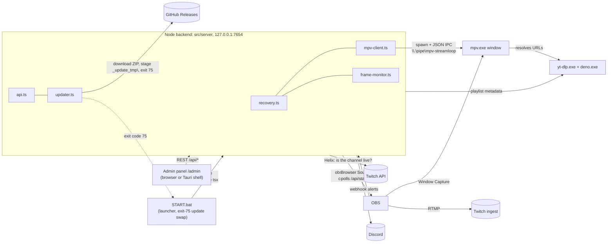
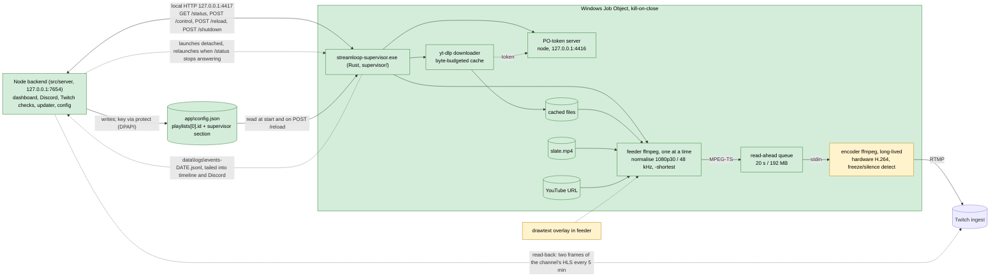

# Architecture

How the parts fit. Direction, decisions and spike results live in the Notion pages named at the end; this file is structure only.

## What it is

Streamloop restreams a YouTube playlist to Twitch around the clock from one Windows box. This branch holds **3.0**: a headless ffmpeg pipeline under a Rust supervisor (`supervisor/`), with no mpv, OBS or desktop session, driven over local HTTP by the Node/TypeScript backend in `src/`. Node owns the config, the dashboard, Discord alerts, the Twitch checks and the updater, and launches the supervisor. `spikes/` keeps the spikes that proved the pipeline. **2.x**, the live release (mpv and OBS), lives on the `2.x` branch.

## 2.x (the `2.x` branch)

This section describes the `2.x` branch. None of these mpv or OBS modules exist in `src/` on this branch.

- `src/server/index.ts`: wires every component by dependency injection, serves `/admin` and `/overlay`, opens the admin page on boot unless `autoOpenAdmin` is off, exits 75 after a staged update.
- `config.ts` / `types.ts`: Zod schema and defaults for `config.json` (gitignored), hot reload via `POST /api/config`.
- `state.ts`: playback position in `state.json`, debounced 2 s writes, suppressed during recovery.
- `mpv-client.ts` / `mpv-args.ts`: spawns mpv, talks JSON over the named pipe, polls properties, receives events.
- `recovery.ts`: 5 s heartbeat, stall / video-freeze / premature-EOF / non-playing detectors, in-place URL retry, then RetryCurrent, RestartMpv, CriticalAlert.
- `frame-monitor.ts`: hashes OBS screenshots to catch a frozen picture mpv reports as healthy.
- `obs-client.ts`: obs-websocket connection, streaming control, screenshots.
- `playlist-metadata.ts`: yt-dlp flat playlist fetch, cached for the dashboard.
- `event-store.ts`: recovery timeline as daily JSONL in `logs/`.
- `discord.ts`: webhook notifications with templates.
- `twitch.ts`: Twitch liveness check (app token + Helix streams) cross-checked with OBS's streaming state.
- `api.ts`: REST surface for the dashboard and overlay; masks secrets in `GET /api/config`.
- `updater.ts` / `ytdlp-updater.ts`: GitHub Releases updater (own major only, 3.x from prereleases; slim ZIP preferred, SHA-256 verified; stages `app\` and `START.bat` only, a different bundled Node is a notice); yt-dlp self-update.
- `logger.ts` / `file-log-transport.js`: pino to console and file.
- `spawn-cwd.ts`: the temp folder every child process starts in, so nothing holds `app\` during the update swap.
- `src/admin/`: dashboard (status, timeline, transport, config, update button). `src/overlay/`: now-playing page for the OBS Browser Source.
- `scripts/START.bat`: preflight (also `supervisor\`, `ffmpeg\`, `pot\`), half-swap self-heal before preflight and on every restart, exit-code branching (75 swaps `app\` only, 0 stay down, else restart in 10 s), launcher trampoline via `START.bat.new`.
- `build/prepare-release.js`: on this branch it builds the 3.0 release ZIPs (see Supervisor interface, Packaging); 2.x builds from the `2.x` branch.
- `shell/`: Tauri thin shell (stage 1 of the standalone admin UI track) that shows the local `/admin` in WebView2; not part of the release ZIP yet.

## 3.0 target

Green is proven by a spike, by the stage 2 runs, or by the stage 3 and 4 runs against local MediaMTX, amber is proven only in part, red is design.

| Part | Status | Evidence |
|------|--------|----------|
| Feeder → read-ahead → encoder → RTMP, no drop at seams | Proven | Spike 1 (`spikes/continuity/`): 2 h soak, 1,663-seam stress, 1 h Twitch |
| drawtext now-playing overlay in the feeder | Proven; wired into the supervisor's video feeders (`supervisor/src/overlay.rs`, off with `overlay: false`, none on the slate) | Spike 3 (`spikes/overlay/`), render check at `-ss 600`; on in every stage 2 run |
| Byte-budgeted download cache, standby slate | Proven | Spike 4 (`spikes/buffer/`) |
| Supervisor: process model, Job Object, controls, URL cold start, recovery ladder, token server, YouTube breaker | Proven as product code in `supervisor/` | Spike 5 (`spikes/supervisor/`); stage 2 runs A (1 h, 12 controls), B (every fault) and C (crash and resume) against local MediaMTX with `supervisor/scripts/`, tools only from the install layout |
| Freeze and silence watchdog in the encoder (`freezedetect` -50 dB, `silencedetect`) | Proven against injected faults | Stage 2 run B: freeze acted on 25.1 s after the frozen picture went out and healed, silence at 35.2 s and retried once; no verdict on normal content over runs A and B |
| Hardware encoder on the real box | Open, deferred to the product trial | Spike 2 (`spikes/encoder/`): kit built and dry-run on NVENC and AMF; the box run was skipped (the box has an RTX 2070, NVENC). The product's first-run setup check detects the encoder by test encode and picked NVENC on the dev machine (stage 4 install run); the box itself is still to run. The supervisor still accepts `libx264` |
| Node as HTTP client of the supervisor | Proven (`src/server/`: client, launcher, event bridge, API) | Stage 3 run A (30 min, NVENC, `supervisor/scripts/node-session.mjs`): first-run wizard calls to live in 22 s, the key stored only DPAPI-protected (dummy key in no config, log or data file), 5 dashboard controls each shown in about 1.3 s, Discord alerts for a freeze (1), a killed feeder (1) and a killed encoder (drop and restart in one batched post), no duplicates |
| Supervisor config from `config.json`, `POST /reload` with a live playlist switch, DPAPI key via `protect`, install layout | Proven | Stage 2: run A streamed on a protected key, the key never reached `data\` (grep, runs A to C); a reload switched to another playlist's video 0 and back |
| Launch by Node, as a sibling that outlives it | Proven (`src/server/supervisor-launcher.ts` through the supervisor's `launch` intermediate, relaunch with backoff) | Stage 3 run B: Node killed, Node exiting 75, and a console control event on the launcher console each left the same supervisor process streaming with no reader gap (largest packet gap 85 ms), and the restarted Node attached in under 1 s with one supervisor; a killed supervisor was relaunched in 4.7 s and resumed at its saved position (91.333 s); after Stop stream nothing relaunched for 48 s, Start relaunched in 0.2 s. Final fix wave run `treekill`: the supervisor's parent was the exited `launch` intermediate (its `launched` event reported `breakaway: true`), `taskkill /T /F` on the outer Node ended Node's tree (three processes) and left the same supervisor PID streaming (largest packet gap 112 ms, no reader reconnect), and a new Node attached on its first poll |
| Twitch read-back (`src/server/twitch-readback.ts`) | Proven against local HLS | Stage 3 run C, with the read-back pointed at MediaMTX's HLS through a test-only override and Twitch never asked: a stale picture (clock included) gave two bad reads, one `restart-encoder`, then the encoder restarted and the stream read as moving again (the script's own grab, diff 4.69); a second stale picture right after it gave two bad reads and, 10 min after the restart, one critical alert and no restart. A `freeze-video` fault is not its case: the overlay clock keeps moving over a frozen picture (clock-region difference 3.8 to 9.2 against a threshold of 1.0), so the encoder's own watchdog handles it |
| Release ZIPs and install beside 2.x (`build/prepare-release.js`, `scripts/START.bat`) | Proven | Stage 4 install run (`supervisor/scripts/install-session.mjs`, v3.0.0 ZIPs): the full ZIP extracted into a temp folder with a space and an `Ö` in its path and started from its own `START.bat`, hidden; Node came up in 3.1 s and wrote `config.json` from the example (no ZIP ships one); the wizard's API calls took it live against local MediaMTX in 22.1 s with the PO-token server adopted, and the key was stored only DPAPI-protected (the dummy key in none of the 10,842 install files) |
| First-run setup check (`src/server/setup-check.ts`) | Proven on the dev machine | Same run: `POST /api/setup-check/run` tried `h264_nvenc` first and kept it, recommended a 4,096 MB cache, found all 9 dependencies, and the wizard saved only the changed cache size |
| 3.x updater, app-only swap (`updater.ts`, exit 75) | Proven | Same run: the update ZIP staged into `_update_tmp\` by the installed `stageUpdate` (`app\` and `START.bat`, no `yt-dlp\`), then the test exit-75 hook: `START.bat` swapped `app\`, kept `config.json`, cleaned up and had Node back in 16.4 s; the same supervisor PID and encoder generation kept streaming (largest reader gap 92 ms, no reconnect) while a yt-dlp download that began 2 s before the hook finished normally; `yt-dlp\` hashed identical before and after. The installed `checkForUpdate` on GitHub's real release list (all 2.x) offered nothing; with one made-up `v3.0.1` prerelease added it offered 3.0.1, and `pickRelease` for 2.3.8 still took v2.3.8 |
| Switching between 3.0 and 2.x | Proven | Same run: Stop from 3.0's dashboard ended the supervisor in 1.4 s, then 3.0's Node tree was killed; v2.3.8's full ZIP (checksum verified) started beside it, its dashboard answered on 7654 and its own stream guard read `127.0.0.1:4417/status` as not streaming; 2.x shut down cleanly; 3.0 started again and stayed stopped for 30 s with no supervisor, Start took it live in 20.1 s, and 2.x's guard then read it as streaming |
| Binary updates of `supervisor\`, `ffmpeg\`, `pot\`, `node\` | Full ZIP only, by hand | The updater never delivers them (yt-dlp updates itself with `yt-dlp -U` when Node starts); a release that changes one says so in its notes, and `node-version.txt` flags a new Node in the dashboard |

## Supervisor interface (3.0)

- **Install layout** under the root (`--root`, default the parent of the exe's folder; `supervisor/src/paths.rs`): `ffmpeg\ffmpeg.exe`, `yt-dlp\yt-dlp.exe`, `yt-dlp\deno.exe`, `yt-dlp\plugins\`, `pot\build\main.js` (token server), `node\node.exe`, `supervisor\streamloop-supervisor.exe`, `supervisor\slate.mp4`, `app\config.json`, `data\`. Every tool is called by full path, never through PATH; yt-dlp gets `--ffmpeg-location` for its merge.
- **Packaging** (`build/prepare-release.js`): the full ZIP is the whole install layout plus `START.bat`; `pot\` is the bgutil token server (2.0.0) built under the bundled Node, and `yt-dlp\plugins\` holds its yt-dlp plugin zip. The update ZIP is `app\` and `START.bat` only. Neither ships `app\config.json`; Node creates it from `config.example.json` on first start, so a reinstall keeps the user's. `build/release-layout.js` lists the required paths, its test reads them from `paths.rs`, and `build/verify-release.mjs` checks each built ZIP.
- **CLI:** `streamloop-supervisor.exe [--root DIR] [--config FILE] [--data DIR]`. Dev only: `--target URL` (replaces ingest and key, for local MediaMTX) and `--debug-faults`, which also unlocks the test knobs (`--url-ttl-s`, `--url-refresh-margin-s`, `--limit-rate`, `--start`, `--max-videos`, `--hours`). `streamloop-supervisor.exe launch ARGS` starts the supervisor with ARGS through a short-lived intermediate: it re-execs itself detached, in a new process group and outside the caller's job (`CREATE_BREAKAWAY_FROM_JOB`; when the job refuses breakaway it starts inside the job instead), logs a `launched` event with `breakaway: true|false`, waits up to 3 s for the port to answer or the child to exit, and exits 2 when the child found the port taken, else 0. `streamloop-supervisor.exe protect` reads a stream key on stdin and prints a DPAPI blob (current user) for `supervisor.streamKeyProtected`.
- **Config** (`app\config.json`, owned by Node): `playlists[0].id` plus a `supervisor` object: `ingestUrl`, `streamKeyProtected`, `encoder`, `cacheBudgetMb`, `readAheadSeconds`, `playerClient`, `overlay`, `freezeSeconds`, `silenceSeconds` (minimums: read-ahead 2 s, freeze and silence 5 s, cache 50 MB). Read at start and on `POST /reload`, which applies what it can live, reports `restartRequired` for ingest, key, encoder and the freeze and silence durations, and switches to a new playlist's video 0 when `playlists[0].id` changes.
- **HTTP** on 127.0.0.1:4417: `GET /status` (`state`: `starting`, `playing`, `recovering`, `needs-stream-key`, `waiting-for-playlist`, `stopping`; `reason`; `streamKeyProblem`; now playing; encoder alive, speed, CPU; watchdog; YouTube breaker; token server), `POST /control` (`{"cmd"}`: `next`, `prev`, `restart`, `jump` with `index`, or `restart-encoder` with an optional `reason` of up to 200 characters), `POST /reload`, `POST /shutdown`, and `POST /debug/fault` only with `--debug-faults`. With no usable key it stays up in `needs-stream-key` and a reload with a working key starts the encoder.
- **Data** (`data\`): `state.json` (resume point), `cache\` (wiped at start, so a resume plays from its URL), `logs\` with daily files (`events-DATE.jsonl`, `seams-`/`controls-`/`encoder-`/`downloads-`/`deletes-`/`buffer-DATE.csv`, `ytdlp-`/`tokenserver-DATE.log`), one log per ffmpeg process, `run.json` and `playlist.json`; a week is kept and the key is redacted from all of it. `stopped-by-user` is Node's marker for a dashboard Stop: written on Stop, removed on Start and read when Node starts, so a stopped stream stays stopped across Node restarts.
- **Twitch read-back** (Node, `twitch-readback.ts`): every 5 min while live, two frames of the channel's own HLS 5 s apart through `ffmpeg\ffmpeg.exe`; if the overlay clock stands still twice in a row while Helix says live, Node restarts the encoder, at most once per 30 min, then only alerts.
- **Launch by Node** (`supervisor-launcher.ts`): Node polls `GET /status` every 2 s and, after 3 misses, runs `ROOT\supervisor\streamloop-supervisor.exe launch --root ROOT` hidden and with no stdio (backoff 10 s, 30 s, 60 s, 5 min). An exit code 2 from the intermediate means another supervisor holds the port, and Node attaches to it. It never stops the supervisor except for the dashboard's Stop stream, after which it relaunches nothing until Start, also across Node restarts through `data\stopped-by-user`. ROOT is the parent of `app\` when `node\` sits beside it, else `STREAMLOOP_ROOT` (dev). `STREAMLOOP_DEBUG_FAULTS=1` adds `--debug-faults`, for test runs only.
- **Measuring harness:** `supervisor/scripts/` (`dev-root.mjs` builds a dev root in this layout, `session.mjs` runs one supervisor session against local MediaMTX, `drive.mjs` drives it over HTTP only, `analyze.mjs` computes the verdict, `node-session.mjs` runs the real Node server against the same root with cwd `ROOT\app`, `install-session.mjs` installs, updates and switches the `dist/` ZIPs in temp folders).

## Main flows (3.0)

- **Seam.** A new feeder starts when the timeline is less than 20 s ahead of the encoder. It begins at timeline offset = last video PTS written + one frame, so timestamps stay continuous. The encoder never sees a seam as anything but more MPEG-TS.
- **Control (next, prev, restart, jump).** All four are `switch(index, 0)` computed from `P_view` (what the viewer sees, not what the feeder has reached): kill the feeder, flush the queue from the first video PES at least 1 s past the writer, start the target feeder on the continuing offset from the cached file or, if not on disk, its URL (slate covers the resolve). Last command wins. `restart-encoder` (for Node's Twitch checks) takes the encoder-down path of recovery step (3) and logs `encoder-restart-requested` with the caller's reason; while a restart is already pending it answers `alreadyRestarting: true`, and in `needs-stream-key` it answers 400.
- **Cold start.** Slate on air at once; the first video's URL is resolved (`yt-dlp -j`, waits for `available_at`) and switched in; the downloader fetches that video first; when the file is complete the URL feeder is killed and a file feeder continues at `P_fed` with no flush.
- **Recovery.** (1) Feeder fails, stalls (no video PES for 10 s) or ends early: restart in place at `P_fed`, 2 tries per video. A picture the encoder's `freezedetect` finds frozen for `freezeSeconds` (counted from 5 s into a seam, never on the slate) takes the same ladder: retry, retry, skip. Audio silent for `silenceSeconds` gets one restart in place; a silence that begins again within 5 s of that restart is the video's own ("brb" stretches): the watchdog event's outcome is `content`, play goes on and nothing is skipped. A later, separate silence gets its own retry. (2) Then skip; 3 skips in a row is critical. A video YouTube will not serve (removed, private, blocked, age-gated) is skipped at once; from the third such video in a row (no successful resolve between them) each one counts toward the breaker. When every video has been skipped, the slate airs for 60 s, doubling to 30 min, before the list is tried again. (3) Encoder exits or its progress stops for 10 s: restart with backoff, probing the ingest port; current video resumes at `P_view`. (4) Supervisor crash: Job Object kills every child, Node relaunches it, it resumes from `state.json`.

## Invariants

- The RTMP connection survives every seam, control and feeder failure; only an encoder restart drops it. (Spike 1, spike 5)
- Nothing in `src/` imports from `spikes/`. Spike code is throwaway; what carries forward is command lines and measurements. (Notion rules; true today)
- Secrets are never committed, printed or logged. Node keeps them in gitignored `config.json` and masks them in `GET /api/config`; spike scripts read `TWITCH_STREAM_KEY` from the environment. The stream key is stored only DPAPI-protected in `config.json`, and the supervisor redacts it from every log, event and `run.json` it writes.
- The supervisor's children die with the supervisor: they live in its kill-on-close Job Object. Node spawns its own children with `cwd: SPAWN_CWD`, so none holds `app\` during an update. The supervisor itself is not Node's child; see the sibling point below.
- YouTube traffic from the supervisor goes through one gate: resolves at least 5 s apart, and a circuit breaker that stops all yt-dlp on a bot check or 3 failed resolves (backoff 1, 2, 5, 10, 30 min).
- `START.bat` never overwrites itself in place, and its parenthesised blocks use `rem`, never `::` (`launcher.test.ts`).
- State is not written while a recovery or switch is in progress, so a transient position cannot overwrite the resume point.
- Media bytes never pass through a loop that also does disk writes or control work, and a critical output is never teed synchronously with a non-critical one. (Spike 1 lessons)
- The supervisor is a sibling of Node, not its child: Node restarts and app updates must not drop the stream. Node starts it through `streamloop-supervisor.exe launch`, an intermediate that exits once the supervisor is up, so the supervisor's parent is dead and it has left Node's job when the job allows breakaway: no tree kill (`taskkill /T`, "End process tree") and no job of Node's reaches it.
- 2.x (from 2.3.7) will not start its OBS stream while `GET 127.0.0.1:4417/status` reports `encoder.alive: true`, so 3.0 must keep that endpoint and field. The check fails open: anything else lets 2.x stream (`src/server/stream-guard.ts` on the `2.x` branch).
- The other way round, Node does not launch the supervisor while `obs64.exe` runs, since 2.x may be streaming on the same key. Before each launch it also test-encodes with the user's `preferredEncoder` and saves a working fallback to `encoder`, or the preference again once it works (`src/server/setup-check.ts`); the supervisor reads only `encoder`.
- 2.x (from 2.3.7) only updates to releases with its own major version; 3.x releases are never marked "latest" on GitHub, because older 2.x installs still read it.

## Where things live

- **Notion** for direction, decisions and spike results: the Notion page *Streamloop* (product direction, 2.x roadmap), *Streamloop 3.0: pipeline spikes* (rules, spike verdicts) and *Streamloop 3.0: product build* (build plan). Fragile assumptions are tracked in the **watch list** at the bottom of the 3.0 spikes page.
- **GitHub issues** for bugs: [Sponsorn/streamloop/issues](https://github.com/Sponsorn/streamloop/issues).
- **This file** for structure. Code-level detail stays in `CLAUDE.md` and the code.
